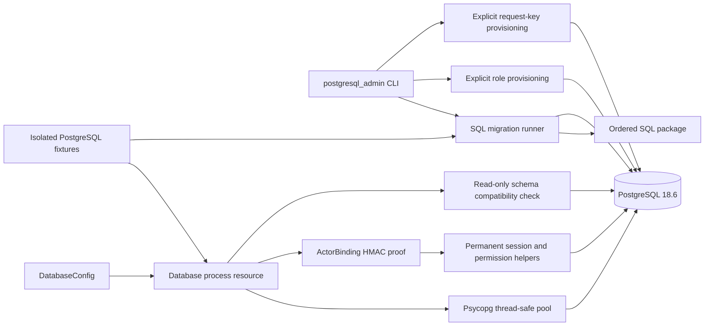

# PostgreSQL foundation operations

This documents the additive migration stage. The application still uses SQLite
until all PostgreSQL repositories and authentication storage are ready. Existing
SQLite and Keycloak files/volumes are retained. Do not deploy an incomplete
cutover by pointing the current application at PostgreSQL.

## Local isolated PostgreSQL setup

Use the project Python 3.14 environment with the pinned requirements installed:

```powershell
.venv/Scripts/python.exe -m scripts.configure_postgresql
docker compose --env-file .local/postgresql.env -f docker-compose.postgresql.yml -f docker-compose.postgresql-test.yml up -d --wait postgres
.venv/Scripts/python.exe -m scripts.postgresql_admin --env-file .local/postgresql.env --url-variable POSTGRES_TEST_ADMIN_URL provision
.venv/Scripts/python.exe -m scripts.postgresql_admin --env-file .local/postgresql.env --url-variable POSTGRES_TEST_ADMIN_URL migrate
.venv/Scripts/python.exe -m scripts.postgresql_admin --env-file .local/postgresql.env --url-variable POSTGRES_TEST_ADMIN_URL configure-security
.venv/Scripts/python.exe -m dotenv -f .local/postgresql.env run -- .venv/Scripts/python.exe -m pytest -q -p no:cacheprovider tests/postgresql
```

The generator exclusively creates `.local/postgresql.env` and refuses overwrite.
It generates separate operator and runtime passwords and a 256-bit
`DATABASE_CONTEXT_KEY` without printing them. Existing configuration created
before actor binding needs that additional deployment-managed key. The
`configure-security` operator command installs its exact value after migration;
it never generates a replacement implicitly. Key rotation takes effect on
subsequent transaction snapshots and requires coordinated server configuration.
The operator URL is supplied explicitly to commands; runtime configuration never
falls back to it. The test overlay exposes PostgreSQL only on loopback port 15432;
omit that overlay for internal-network-only deployment.

The official PostgreSQL image creates the initial operator role for cluster
administration. `provision` explicitly creates `eppm_runtime` (nonlogin group)
and `eppm_app` (restricted login), without changing existing passwords. Runtime
pool startup rejects database owners, elevated roles and schema creators,
including privileges reachable through non-inherited `SET ROLE` membership.
`migrate` applies an entire pending ordered SQL package atomically with checksum
verification and a transaction advisory lock. `check` reads compatibility only.

Tests create databases named `eppm_test_<random UUID>` using explicit setup
credentials. Their pooled queries run as the separate nonowner runtime login.
Cleanup targets only the random database each fixture created. It never resets
an environment-selected database or deletes a Docker volume.

## C3 — Implemented foundation components



`Database.run` supplies repeatable-read read-only snapshots or serializable
read-write callbacks. It repeats trusted actor binding and the entire callback
only for definite serialization/deadlock rollbacks, at most three attempts.
Connection loss, statement timeouts and uncertain commits are not replayed.
Commit/rollback finishes before pool return; reset discards session-level changes.
`TransactionRunner` is the database-independent application port for subsequent
gateway integration. Application composition and ASGI lifecycle integration are
not yet switched in this additive milestone.
