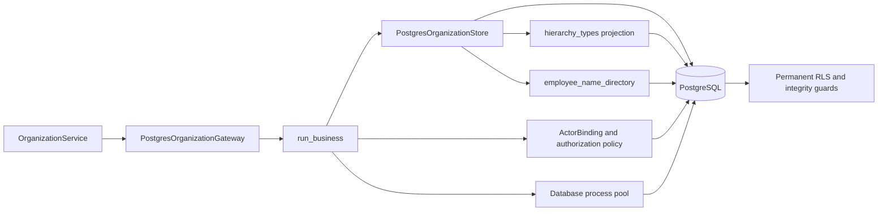

# PostgreSQL organization repository

This is an implemented part of the migration branch. The current application
composition still uses the existing SQLite repositories until the remaining
business subsystems are ready for cutover.

## Contracts and behavior

`OrganizationGateway.run` accepts a complete use-case callback. Team details and
membership replacement, employee creation and its initial calendar exception,
and calendar overlap validation now execute inside that callback. Normalized
command inputs are retained across retries; mutable membership lists and initial
calendar records are copied before execution.

`PostgresOrganizationGateway` injects the process pool, server signing key and
`BusinessAccess`. `run_business` binds the actor and checks the requested
permission and business read scope in the same snapshot on every attempt. Native
row policies and mutation guards remain authoritative when a store is called
without the service's permission argument. A `DeploymentActor` cannot use the
runtime gateway; operator operations require their separate connection path.
Permission failures produce one safe event after rollback. Constraint and storage
failures are translated to the existing organization application errors without
exposing SQL diagnostics or credentials.

The native store preserves the existing contracts:

- Generated identities come from `RETURNING`; missing records keep their
  established `None`/boolean results.
- Function flags use native booleans. Calendar domain models receive Python
  dates; `CalendarExceptionRow` explicitly formats ISO dates regardless of the
  PostgreSQL session's `DateStyle`.
- Inclusive overlap checks run inside the serializable write callback, backed
  by the permanent database overlap guard. After a conflicting commit, the whole
  service callback rechecks the interval.
- Membership replacement locks its team, deletes old members and inserts the
  deduplicated set together. `ON CONFLICT` ignores only a duplicate membership;
  foreign-key and other integrity failures still abort the operation.
- Text ordering uses `COLLATE "C"` where the existing repository uses SQLite's
  binary ordering. Hierarchy codes remain stable and localized labels are
  replaced atomically. Team hierarchy assignment remains optional.

The existing `EmployeeReference` boundary contains only function ID, first name
and last name. Migration `0009_organization_references.sql` adds a permanent
security-barrier `employee_name_directory` for that projection, gated by business
read access. The base employee/calendar tables remain private to shared-data
administration. Contact information, employee codes and occupation percentages
are not columns of the directory. Function reporting labels have a separate
explicit projection. This preserves current project-label behavior without
loading private employee DTOs for a scoped reader.

## C3 — Implemented organization components



## Validation

The unchanged organization/hierarchy workflows plus the callback integration
passed **197 checks in 102.74 seconds**:

```powershell
.venv/Scripts/python.exe -m pytest -q -p no:cacheprovider tests/test_layered_organization.py tests/test_hierarchy_types.py tests/test_layered_organization_ui.py tests/test_business_transaction_security.py tests/test_layer_boundaries.py
```

Native organization, security and integrity checks passed **80 checks in 42.88
seconds**, with **168/168 statements covered** across `organization.py`,
`hierarchy.py` and `business.py` in the PostgreSQL package:

```powershell
.venv/Scripts/python.exe -m dotenv -f .local/postgresql.env run -- .venv/Scripts/python.exe -m pytest -q -p no:cacheprovider tests/postgresql/test_organization.py tests/postgresql/test_business_security.py tests/postgresql/test_integrity.py --cov=app.infrastructure.postgresql.organization --cov=app.infrastructure.postgresql.hierarchy --cov=app.infrastructure.postgresql.business --cov-report=term-missing
```

Logs: `.local/postgresql-organization-legacy.log` and
`.local/postgresql-organization-native.log`. Native checks use separate setup and
restricted runtime credentials, fresh isolated test databases, actual constraints
and real concurrent transactions. They cover compound rollback, direct-store
authorization, name-directory privacy, date and boolean representations,
hierarchy references and safe storage errors. This is subsystem evidence; full
application regression/coverage and 50-user browser acceptance remain pending.

An additional **47 checks passed in 15.80 seconds** after strengthening the race
assertions. Both team and calendar tests require at least one actual callback
retry; the calendar loser must report the service's overlap validation. This run
also includes `tests/postgresql/test_foundation.py`, validating fresh migration
and pool lifecycle behavior with the new directory view. Log:
`.local/postgresql-organization-replay.log`.
