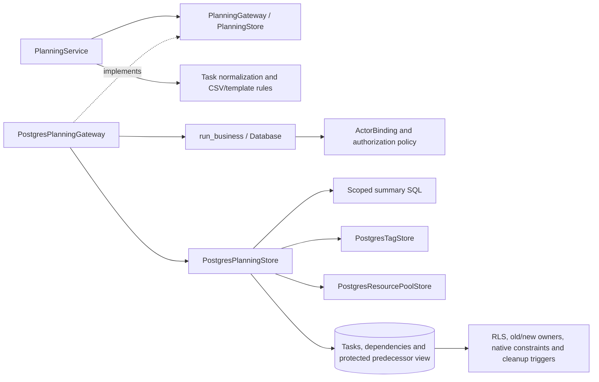

# PostgreSQL task scheduling and dependencies

`PlanningService` now executes complete database callbacks through
`PostgresPlanningGateway`. The native adapter covers task reads and edits, CSV
imports/exports, schedule templates, dependencies, recursive project filters,
summary headers and batched task metadata. Application composition injects the
native gateway; the former SQLite callback bridge is archived outside runtime.

## Transactions and scheduling contracts

Task details and requested predecessors save together. Imports validate their
entire input before inserting, and template replacement validates external
references again within every attempt. Replacement removes the old schedule's
incoming/outgoing links, primary predecessor references, task tags and project/task
allocations before creating fresh task identities and resolving local step links.
A failure rolls back the complete operation, including deletions and earlier
inserts. Other projects' tasks and unrelated records survive.

The transaction runner retries complete serializable callbacks only for known
serialization/deadlock rollbacks. Task values, nested dependency submissions and
batch inputs are copied before callbacks. Concurrent replacements commit complete
templates with internally consistent fresh identities; concurrent date/progress
edits retain both independent fields. These are transaction guarantees, not
planning history, version tokens or stale-form protection.

Dates use native PostgreSQL parameters and return ISO strings independently of
DateStyle. Existing normalization, progress clamping, nullable legacy fields,
zero-duration milestones and the four dependency rules remain unchanged.
Migration `0014_dependency_lag_range.sql` widens the initial dependency lag column
to BIGINT to preserve the signed 64-bit range already accepted by templates.
Summary comparisons subtract dates instead of adding a potentially enormous lag.
Applied migrations remain unchanged.

## Scoped reads and protected references

All task predecessor reads use `eppm.visible_project_task`; the runtime role
cannot select the base table's unredacted predecessor column. Dependency RLS
checks both endpoints before labels, warning flags, counts or graph traversal.
Hidden projects contribute no metadata keys. Active accounts without business
read permission remain denied by the shared business runner.

Recursive project queries traverse task, whole-project and legacy primary links.
One recursive reference and UNION deduplication terminate cycles without banning
existing cyclic warning data. An inaccessible project cannot bridge two visible
parts of the graph. Selectors use bounded literal searches and exact IDs.

Task and dependency edits preserve old/new owner checks. Updating dates or
progress does not remove a hidden primary predecessor. Saving visible dependency
selections preserves hidden links; a caller cannot silently clear a hidden primary
reference. Deleting a task or replacing its schedule fails atomically when hidden
foreign-key references or uneditable owners prevent cleanup.

Task bundles batch tasks, dependencies, tags, pools, project names and referenced
whole-project bounds in one repeatable-read snapshot. Compact summary SQL
aggregates only visible sources, preserving task-endpoint precedence, signed lags,
empty projects, progress averages and FS/FF/SS/SF warnings without hydrating every
task. It does not reuse globally cached warnings.

## C3: components



## Validation and remaining work

Existing schedule, template, UI, projection and layer checks passed **146 tests
in 24.50 seconds**. The broader native planning, resource, business-security,
integrity, schema and foundation suite passed **194 tests in 65.91 seconds**.
All native scheduling adapter statements were exercised. Tests use real restricted
runtime connections and randomly named isolated PostgreSQL databases.

The final native suite passed **45 tests in 18.83 seconds**, including additional
external-template, nullable-field and hidden-link editing cases. The service and
native adapters cover **305/309 statements (98.71%)**; both native adapters have
100% statement coverage. This is subsystem evidence, not the final application
coverage or browser performance gate.

```powershell
.venv/Scripts/python.exe -m pytest -q --tb=short -p no:cacheprovider tests/test_layered_planning.py tests/test_layered_planning_reads.py tests/test_layered_planning_ui.py tests/test_dependencies.py tests/test_schedule_export.py tests/test_planning_dependency_filters.py tests/test_project_template_workflows.py tests/test_planning_read_projections.py tests/test_layer_boundaries.py
.venv/Scripts/python.exe -m dotenv -f .local/postgresql.env run -- .venv/Scripts/python.exe -m pytest -q --tb=short -p no:cacheprovider tests/postgresql/test_planning.py tests/postgresql/test_business_security.py tests/postgresql/test_integrity.py tests/postgresql/test_schema.py tests/postgresql/test_foundation.py tests/postgresql/test_resource_pools.py
```

Logs: `.local/postgresql-planning-legacy-expanded.log`,
`.local/postgresql-planning-native-expanded.log` and
`.local/postgresql-planning-native-final.log`. Coverage:
`.local/postgresql-planning-coverage.json`.

[Native derived caches](postgresql-derived-caches.md) now separate summary reads
from publication. The native gateway computes missing headers in repeatable read,
publishes against current source/security keys in a separate serializable
transaction, and reauthorizes all memory and database hits. Capacity inputs and
caches are also ported. Portfolio queries, native runtime/operator tooling,
project money forms, full regression coverage, the 50-user browser acceptance
runs and backup/restore/restart gates remain.
