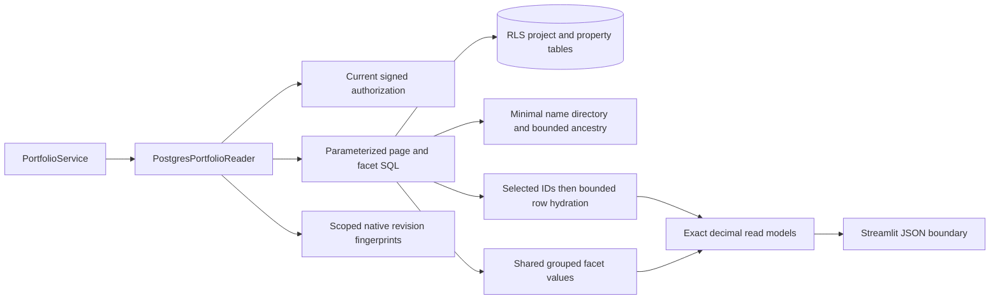

# PostgreSQL portfolio reads

`PostgresPortfolioReader` now implements the portfolio read port with native
Psycopg queries. Counts, pages, facets, metrics, details and reference catalogs run
under current signed authorization in repeatable-read transactions. RLS filters
projects before pagination, totals, joins and property projections. Revisions use
the existing native actor/scope/source fingerprints; session activity and hidden
project edits do not invalidate an unrelated reader's results.

## Bounded query behavior

Pages retain the existing 100-row limit, offset clamping, stable project-ID tie
break, include/exclude filters, template selection and literal search. A page
first selects IDs under its filters and ordering, then hydrates only those rows.
This prevents late offsets from evaluating discarded rows' dynamic properties.
Only server-owned column expressions are compiled; identifiers are quoted with
Psycopg and all filter/property values are bound parameters. ASCII case folding
preserves the previous SQLite search/sort behavior.

Dynamic property projections check current template applicability and preserve
actual numeric, ISO date, text and ordered-list kinds. JSONB handles mixed
property result types, with Decimal parsing registered only on the relevant
cursor. Ordinary pooled connections retain their default JSON decoding.

Facets ignore their own selection while respecting other filters. One statement
materializes the requested scoped values, groups them once, and shares that
result between statistics, most-common value and at most 200 choices. Search
applies to choices without narrowing the all-result statistics. Numeric means
weight each distinct value by its frequency. Missing values, zero, empty
selections and unknown columns retain their established behavior.

## Monetary and reference boundaries

Native NUMERIC budgets, numeric properties, extrema, sums and averages remain
Decimal through the reader/service boundary. Aggregate calculations use working
precision derived from the native totals and their scales. The existing budget
domain function retains the variance and burn-rate conventions.

The Streamlit component converts decimals to exact strings immediately before
JSON transfer. Browser display formatting remains unchanged, while selected facet
values return every digit. Numeric filters accept these strings as bound native
NUMERIC values, preserving exact matching beyond binary64 precision.

Manager labels use the existing name-only employee directory. Full employee and
staffing access is unchanged. Reporting ancestry has explicit cycle detection
and retains the existing 20-level traversal bound. Catalog reads defer manager
choices when they are not needed by an editor.

## C3: components



## Verification

The initial native/existing service and transport run passed **52 tests in 11.75
seconds**. A broader run passed **187 tests in 74.83 seconds**, including native
project/property, security, revision and cache checks. All portfolio service and
native query/reader statements were covered.

After the query improvements, the native suite passed **14 tests in 8.00
seconds**, with **160/160 native statements covered (100%)**. The real-browser
suite passed **3 tests in 9.29 seconds**, including exact decimal facet selection
through the component; the captured pytest exit code is **0**. Existing Playwright
shutdown warnings remain in that log. **15 JavaScript component tests** passed.
Browser layout tests still use staged legacy composition; the decimal test uses
the real component with an explicit exact-value fixture.

The final combined portfolio/service/transport/layer run passed **54 tests in
26.79 seconds**, covering **203/203 statements (100%)** across the portfolio
service and native reader/query modules.

The isolated 10,001-project query probe improved from **2.8143 seconds** for two
page reads and one numeric facet to **0.2220 seconds**: first page **0.0597 s**,
last page **0.0438 s**, facet **0.1184 s**. It verifies bounded output under one
authorized native test actor, with numeric properties and a small reference
fixture. It is not the complete migration workload, a percentile measurement,
a browser measurement or evidence for the 50-user acceptance target.

```powershell
.venv/Scripts/python.exe -m dotenv -f .local/postgresql.env run -- .venv/Scripts/python.exe -m pytest -q --tb=short -p no:cacheprovider tests/postgresql/test_portfolio.py tests/test_portfolio_decimal_transport.py tests/test_layered_portfolio.py tests/test_portfolio_paging.py tests/test_portfolio_http.py tests/test_layer_boundaries.py --cov=app.infrastructure.postgresql.portfolio --cov=app.infrastructure.postgresql.portfolio_query --cov=app.application.services.portfolio --cov-report=term-missing --cov-report=json:.local/postgresql-portfolio-coverage.json --cov-fail-under=95
.venv/Scripts/python.exe -m pytest -q --tb=short -p no:cacheprovider tests/test_portfolio_layout_browser.py
node --test tests/test_portfolio_table.cjs
```

Logs: `.local/postgresql-portfolio-validation.log`,
`.local/postgresql-portfolio-expanded.log`,
`.local/postgresql-portfolio-native-final.log` and
`.local/postgresql-portfolio-browser.log`. Coverage:
`.local/postgresql-portfolio-coverage.json` and
`.local/postgresql-portfolio-native-coverage.json`. Probe timings:
`.local/postgresql-portfolio-large.xml`.

## Remaining migration work

The dashboard reader still requires its native port, including the existing
aggregate-only competing-demand behavior. Runtime/operator/seed/benchmark
cutover, shared process-state injection, project monetary-input conversion and
SQLite runtime archival remain. Final application coverage, authenticated native
browser operation, three 50-user measurements and backup/restore/restart gates
are still required before the migration can be accepted.
