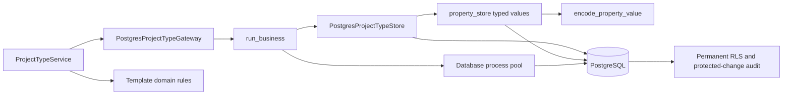

# PostgreSQL project templates and typed properties

Project-type services now use complete callbacks through
`PostgresProjectTypeGateway`. Each attempt binds the actor and rechecks
authorization, rename/deletion guards and property applicability in the same
transaction. The service copies list defaults before starting an operation so a
retry uses the original selection input. The current application composition
remains on SQLite until all required repositories are ready for cutover.

## Preserved contracts

The native adapter preserves the General template, case-insensitive unique type
names, binary display ordering, selected-only properties, nullable required
overrides and deletion guards. Applicability changes retain inactive defaults
and overrides so restoring applicability restores those values.

`property_store` reads parent values and ordered list items in one scoped join.
Row policies apply before results are returned; hidden project values and list
items do not enter the result. Empty property filters return no values. There is
no per-project value-loading loop. The writer validates the declared property
type and enum choices before replacing a value and its items inside the caller's
transaction.

The representation remains explicit:

| Stored state | Application result |
| --- | --- |
| No row | Property/default absent |
| `null` | `None` |
| `empty` | Empty string |
| `list` without items | Empty list |
| `list` with items | Text selections in stored position order |
| `number` | Native `Decimal` from PostgreSQL `NUMERIC` |
| `date` | ISO date string, independent of PostgreSQL `DateStyle` |
| `text` | Original text value |

Domain validation accepts finite Decimal values without conversion to float.
Integer and Decimal inputs persist exactly; existing numeric form inputs are
converted once at the storage boundary. New migration
`0010_finite_property_numbers.sql` enforces the finite-number invariant for both
project values and template defaults, including direct SQL writes. It adds no
rounding or numeric scale. This does not complete the separate pending port of
project budget fields and financial calculations to Decimal.

Rules, default values, selection items and their required protected-change audit
commit or roll back together. Native database diagnostics are translated to the
existing safe project-type errors after rollback or bounded callback replay.

## C3 — Implemented template components



## Validation

- **82 existing checks passed in 13.99 seconds**: project-type service/domain/UI,
  projects, schema and layer boundaries. Log:
  `.local/postgresql-project-types-legacy.log`.
- **139 native checks passed in 40.10 seconds**: project templates and typed
  values, business security, scope resolution, migrations and pool foundation.
  The new `project_types.py` and `property_store.py` adapters have **110/110
  statements covered**. Log: `.local/postgresql-project-types-native.log`.
- **40 follow-up checks passed in 1.41 seconds**: domain validation plus inactive
  default restoration, the type-delete/exclusive-assignment race, and preservation
  of the original selection list across a definite PostgreSQL rollback. Log:
  `.local/postgresql-project-types-replay.log`.

Native checks use explicit test URLs from ignored `.local/postgresql.env`,
separate operator/runtime credentials and disposable `eppm_test_<UUID>` databases.
Only setup uses operator credentials. The tests exercise actual native numeric
values, constraints, audit failures, repeatable snapshots and serializable races.

The broad native command was:

```powershell
.venv/Scripts/python.exe -m dotenv -f .local/postgresql.env run -- .venv/Scripts/python.exe -m pytest -q -p no:cacheprovider tests/postgresql/test_project_types.py tests/postgresql/test_business_security.py tests/postgresql/test_scope_resolution.py tests/postgresql/test_foundation.py --cov=app.infrastructure.postgresql.project_types --cov=app.infrastructure.postgresql.property_store --cov-report=term-missing
```

These results validate this subsystem. Full-codebase coverage, runtime cutover,
browser performance and recovery acceptance remain separate pending gates.
