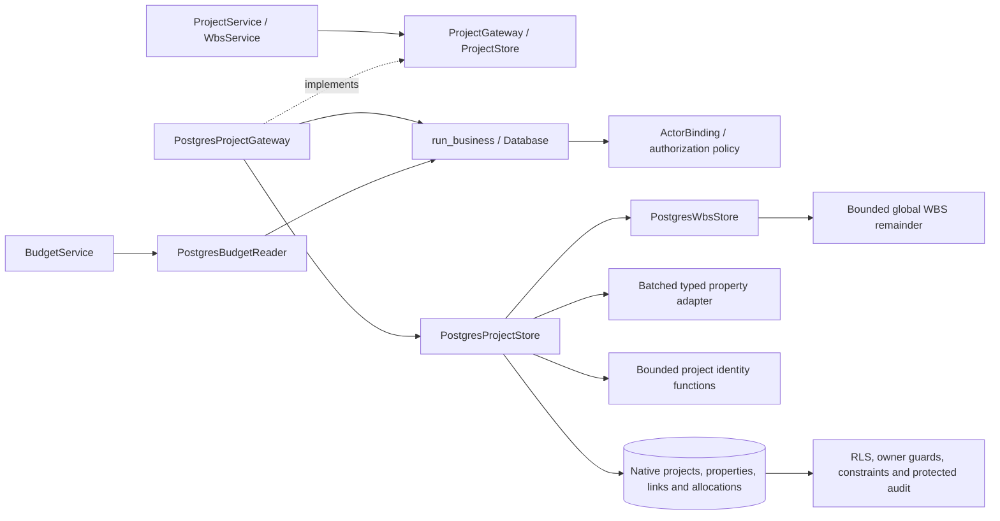

# PostgreSQL projects, WBS and budget reports

Project and WBS services now execute complete callbacks through
`PostgresProjectGateway`. Each attempt binds the current actor and rechecks
authorization. Reads share a repeatable-read snapshot; serializable writes retry
the whole operation only after a definite serialization or deadlock rollback.
Submitted property lists, links and allocations are copied before retryable work.

Project creation and updates commit master data, typed properties, links and WBS
shares together. Each creation attempt resolves the current General type and
effective defaults again. Updates retain inactive properties without reapplying
creation defaults. Property definitions and choices are loaded in batches;
parent values and ordered list items are written together. Planning catalogs
batch requested active values and applicability without per-project hydration.

## Monetary boundary

Project records normalize budgets to finite Decimal euros. PostgreSQL NUMERIC
round-trips those values without a float conversion, including fractional euros
and amounts beyond JavaScript's exact integer range. Existing nullable budgets
read as Decimal zero. Project amounts retain their existing unscaled contract;
this change does not apply the finance grid's cent rounding to project budgets.

`PostgresBudgetReader` selects only visible project identity, name, status and
budget amounts. Row policies filter before reporting, and no custom property
hydration is needed. Tests verify exact stored amounts and report arithmetic.
The browser project editors now transport decimal strings and validate them
before saving, including values beyond JavaScript's exact integer range. The
deployed smoke check and native regressions are recorded in the
[runtime guide](postgresql-runtime.md#exact-project-money-forms). The former
SQLite adapter is retained only in the historical archive.

## Identity and shared WBS capacity

Migration `0012_project_operations.sql` adds three bounded native functions with
fixed search paths and explicit runtime execution privileges:

- `wbs_options` returns catalog metadata and global remaining percentages,
  including hidden projects' usage without exposing their identities. Subtracting
  an edited project's current share requires read access to that project. New
  project options require creation or shared-administration permission.
- `project_id_preview` requires creation permission and returns a nonbinding
  next identity without advancing the sequence.
- `allocate_project_id` requires creation permission and a serializable write.
  A project-identity advisory lock coordinates explicit and generated IDs. It
  never rewinds the sequence; rollback gaps are expected. This lock applies only
  to project creation, not ordinary edits, catalogs or planning operations.

WBS availability is revalidated within every write attempt. Native integrity
guards enforce the global 100% cap. Concurrent claims that cannot both fit leave
one committed allocation and one domain validation failure after replay. Failed
late checks restore project details, properties, links and prior allocations.
Referenced WBS entries remain protected even when their assigned percentage is
zero. Project deletion clears existing dependency/task records atomically with
the owning project and its cascading children.

## C3: components



## Validation and remaining work

Existing project, template, WBS, budget, UI and layer tests passed **177 checks in
33.98 seconds**. Log: `.local/postgresql-projects-legacy.log`.

Native tests passed **177 checks in 53.80 seconds**, covering exact values,
scope filtering, defaults, inactive properties, protected categorical audit,
explicit/generated ID races, competing WBS claims, graph deletion rollback,
consistent snapshots, safe failures and retained inputs across observed retries.
The native project, WBS, budget and shared property adapters have **195/195
statements covered (100%)** in this run.

```powershell
.venv/Scripts/python.exe -m dotenv -f .local/postgresql.env run -- .venv/Scripts/python.exe -m pytest -q --tb=short -p no:cacheprovider tests/postgresql/test_projects.py tests/postgresql/test_budgets.py tests/postgresql/test_project_types.py tests/postgresql/test_schema.py tests/postgresql/test_integrity.py tests/postgresql/test_business_security.py tests/postgresql/test_foundation.py --cov=app.infrastructure.postgresql.projects --cov=app.infrastructure.postgresql.wbs --cov=app.infrastructure.postgresql.budgets --cov=app.infrastructure.postgresql.property_store --cov-report=term-missing --cov-report=json:.local/postgresql-projects-coverage.json
```

Output: `.local/postgresql-projects-native.log`; coverage:
`.local/postgresql-projects-coverage.json`. All business/runtime/tool ports and
exact browser money inputs are now implemented. Full regression/coverage,
authenticated performance and representative deployed recovery remain required;
see [current migration evidence](postgresql-migration-evidence.md).
## Whole-share storage after runtime cutover

Migration 0021 prevents PostgreSQL's implicit integer rounding from accepting
fractional WBS SQL input. The percentage column now preserves exact NUMERIC
input until its whole-number and 0..100 checks run. This changes no valid share
or allocation rule. `PostgresWbsStore` and `PostgresDashboardReader` return the
same integer percentages required by their existing application contracts.
The native WBS workflow tests verify upgrade preservation, fractional and
nonfinite rejection, scope/ownership checks, concurrent capacity claims,
backed-up resets and the actual Settings/project editors.
