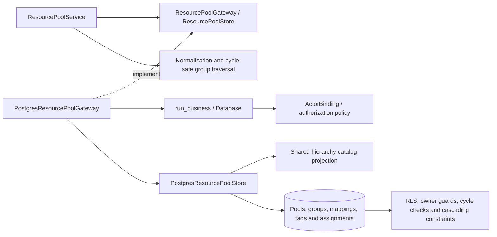

# PostgreSQL resource pools and assignments

`ResourcePoolService` now executes complete authorized callbacks through
`PostgresResourcePoolGateway`. Native operations cover pool and group catalogs,
optional hierarchy classifications, recursive membership, target mappings,
dictionary tags and project/task assignments. Normalization copies submitted
models; collection arguments are copied before replayable work. Each retry
rechecks current references, graph edges and authorization in its new snapshot.

## Atomicity and data contracts

Pool details and selected tags save together. Group details and all selected
pool/child edges also save together. Invalid references or late native failures
restore the prior details and associations. Existing native cascade rules apply
to pool/group deletion; rollback restores all affected records. Shared child
groups and their pools survive deletion of their parent group.

Group traversal terminates deliberately and deduplicates pools reached through
multiple paths. The existing native hierarchy guard and serializable callback
runner protect concurrent edge insertion; a rejected retry revalidates the
updated graph instead of repeating a partially executed statement.

Mapping upserts preserve their identity for the same pool/type/target tuple,
including concurrent submissions. Nonmonetary FTE and allocation percentages
retain their double-precision domain contract. Assignment dates are bound as
native dates and returned as ISO strings; a missing custom endpoint independently
falls back to the task endpoint. Timestamps return the existing UTC text format,
independent of session time zone and DateStyle. Nullable descriptions and notes
remain editable through their empty-string form boundary.

Assignment filters, task/project batches and task/date joins operate after RLS.
Hidden projects contribute no assignment rows or map keys. Task allocations do
not appear in the project-level map. Shared configuration mutations require
shared administration; allocation changes require edit permission on both the
old and new project owners. A task/project owner mismatch remains an access
denial, including for administrators, as required by the existing native guard.
Pool/group selectors retain their narrow application reference models.

## C3: components



## Validation

Existing resource, hierarchy, scoped settings UI and layer tests passed **75
checks in 13.72 seconds**. Log: `.local/postgresql-resource-pools-legacy.log`.
Native resource checks use restricted runtime connections and isolated databases;
they cover complete saves, failed cascades, hidden assignments, native dates,
nullable inputs, snapshot consistency, retained inputs and observed retries.
The service and native adapter cover **272/272 statements (100%)**.

```powershell
.venv/Scripts/python.exe -m dotenv -f .local/postgresql.env run -- .venv/Scripts/python.exe -m pytest -q --tb=short -p no:cacheprovider tests/postgresql/test_resource_pools.py --cov=app.infrastructure.postgresql.resource_pools --cov=app.application.services.resource_pools --cov-report=term-missing --cov-report=json:.local/postgresql-resource-pools-coverage.json
```

The broader native run also exercised business security, integrity, organization,
tags and foundation tests. It passed 153 checks; one resource test incorrectly
expected a constraint error for a task-owner mismatch. That expectation was
corrected to the existing access-denial contract, and the resource suite then
passed **17 checks in 7.53 seconds**. Logs: `.local/postgresql-resource-pools-native.log` and
`.local/postgresql-resource-pools-followup.log`. Coverage:
`.local/postgresql-resource-pools-coverage.json`.

The runtime, capacity/cache integration, scheduling, portfolio/finance, exact
money inputs and tools now use PostgreSQL. Full regression/coverage, authenticated
browser responsiveness and representative deployed recovery remain acceptance
gates; see [current migration evidence](postgresql-migration-evidence.md).

## Relative assignment periods

Project and task allocation dialogs offer full duration, fixed custom dates,
and **Offset + duration**. Relative assignments persist `schedule_anchor`
(`start` or `end`), signed `offset_days`, and positive `duration_days`; their
stored start/end dates are null. Migration 0031 enforces complete, mutually
exclusive scheduling fields. Existing authorization and project ownership guards
apply to all three modes.

Offsets use calendar days and always move forward when positive, including from
an end anchor. Duration includes the first allocation day: May 31 + 10 days with
5 days duration resolves to June 10–14. Moving the start to June 30 resolves to
July 10–14. Negative offsets schedule before the chosen anchor. Project anchors
come from the earliest task start and latest task end. Undated owners retain the
existing project-bound/current-day fallback. Offset limits are ±9124 days and
duration is 1–9125 days, consistent with the capacity reporting horizon.

The domain resolver, joined allocation reads, compact Gantt links, and dashboard
SQL all resolve current dates. Existing task/project revision invalidation makes
schedule edits visible without updating assignment records. The regression tests
cover both anchors and owners, inclusive dates, storage constraints, authorization,
both dialogs, and dashboard parity across quarter boundaries.


### Absolute pool capacity reductions

Edit a pool in Settings and expand Capacity exceptions to create, edit or delete
an inclusive date range, absolute FTE reduction and optional reason. Business
administrators manage these shared records; PostgreSQL RLS and the application
service both enforce this permission. Overlapping reductions add, with effective
capacity floored at zero. A base of 5 with reductions of 0.5 from January 1 through
March 3 and 0.25 from February 1 through November 5 yields 4.25 in the overlap.
Reductions apply after employee staffing/calendar overrides when the pool is staffed.
Migration 0032 stores exceptions and invalidates pool revisions. The Python
capacity calculator, planning grid, assignment generator and native dashboard
aggregation all consume the resulting effective calendar. Migration 0033 adds
per-pool dashboard stacks and validates pool-specific drill-through server-side.
