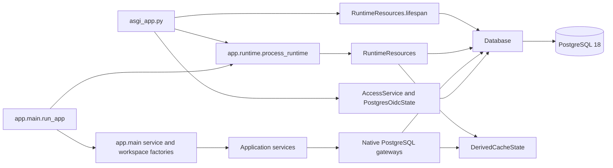

# PostgreSQL runtime cutover

The application entry point, authentication, custom HTTP routes and business
service composition now use PostgreSQL. Every service receives the same
`RuntimeResources`: a restricted process pool, the configured request-signing
key, one bounded derived cache, and an opaque presentation identity. No runtime
factory accepts a SQLite path or substitutes operator credentials.

## C3 — Runtime components



The shared provider constructs a closed resource once. A lock serializes first
calls so concurrent callers cannot create different pools. Only entry-point
composition resolves that provider; services receive their resources and actors
explicitly. Streamlit's user-facing cache clearing cannot replace the pool owned
by the launcher. Configuration changes require a process restart.

The supported `st.App` lifespan opens and checks the pool in a worker thread and
closes it on normal shutdown, startup failure or cancellation. Startup checks
schema compatibility and runtime-role restrictions; it does not migrate, seed,
reset or appoint accounts. The launcher retains the direct `st.App(...)`
assignment required by Streamlit's discovery mechanism. Existing authentication
and download/planning routes continue to offload synchronous database callbacks;
OIDC state storage also runs outside the ASGI event loop.

Navigation permissions are read inside one actor-bound access callback before
page composition. An active account with no business grant still sees the empty
Dashboard and Finance views. Project readers receive scoped portfolio/planning
services, shared-data administrators receive Settings, and access administrators
receive account management. Runtime composition rejects deployment actors.
Planning and capacity adapters share the injected cache while retaining each
actor's scope, session and revision checks.

## Deployment and operator commands

The runtime image includes PostgreSQL 18.6 archive clients from the
[official signed PostgreSQL Debian repository](https://www.postgresql.org/download/linux/debian/).
The Python stages use the 3.14 Debian Trixie image. PostgreSQL remains in its
separate named volume. The existing data mount is retained for old archives and
new PostgreSQL backups; `.dump` files are Git-ignored.

The application receives `DATABASE_URL`, `DATABASE_CONTEXT_KEY` and the pool/
timeout settings. It does **not** receive `DATABASE_OPERATOR_URL`. Explicit
operator commands use their separate URL and write archives to
`DATABASE_BACKUP_DIRECTORY`, defaulting to `.local/backups` outside Docker and
`/app/data/backups/postgresql` in the image. `--backup-directory` overrides it.

For the existing local OIDC deployment, use both ignored environment files.
Generate either file only if it does not exist; generation refuses to overwrite
credentials. `DATABASE_CONTEXT_KEY` must contain a generated 32-byte hex key,
configured explicitly in PostgreSQL before starting the application.

```powershell
$composeArgs = @('--env-file', '.local/oidc.env', '--env-file', '.local/postgresql.env',
    '-f', 'docker-compose.yml', '-f', 'docker-compose.postgresql.yml', '-f', 'docker-compose.oidc.yml')
docker compose @composeArgs up -d postgres keycloak
docker compose @composeArgs build app
.venv/Scripts/python.exe -m dotenv -f .local/postgresql.env run -- docker compose @composeArgs run --rm -T --no-deps --entrypoint python -e DATABASE_OPERATOR_URL -e EPPM_RUNTIME_PASSWORD app -m scripts.postgresql_admin provision
.venv/Scripts/python.exe -m dotenv -f .local/postgresql.env run -- docker compose @composeArgs run --rm -T --no-deps --entrypoint python -e DATABASE_OPERATOR_URL app -m scripts.postgresql_admin migrate
.venv/Scripts/python.exe -m dotenv -f .local/postgresql.env run -- docker compose @composeArgs run --rm -T --no-deps --entrypoint python -e DATABASE_OPERATOR_URL app -m scripts.postgresql_admin configure-security
.venv/Scripts/python.exe -m dotenv -f .local/postgresql.env run -- docker compose @composeArgs run --rm -T --no-deps --entrypoint python -e DATABASE_OPERATOR_URL app -m scripts.postgresql_admin seed-defaults
docker compose @composeArgs up -d --no-deps app
```

These commands forward the operator credential by environment-variable name,
without placing its value in command-line arguments. Add the existing
`docker-compose.postgresql-test.yml` overlay only when the explicit loopback test
port is needed. Do not remove the PostgreSQL, Keycloak or old data storage when
recreating the application container.

The retained `seed_defaults`, `seed_database`, `seed_pool_scenarios`,
`pool_allocations` and `flush_database` command modules now use the same native
maintenance service. Each accepts `--env-file`, `--url-variable` and
`--backup-directory`; database-file arguments are removed. Their existing
generation options and explicit apply/clear/reset confirmations are preserved.
The application module's explicit offline seeding flags also use operator
credentials; ordinary Streamlit execution never invokes that path.

`scripts.access_admin` accepts `--env-file` and `--url-variable`. Its `migrate`,
`pending-accounts`, `bootstrap-admin` and `recover-admin` commands use native
operator connections and retain verified-account, audit and administrator
continuity rules. A new verified OIDC login creates a pending PostgreSQL account.
Inspect it with `pending-accounts`, then explicitly bootstrap the intended first
administrator by its returned user ID. Existing SQLite users, sessions and
grants are not imported. The operator composition module no longer exposes
business-service factories that bypass a runtime actor.

## Verification and remaining acceptance

Native tests exercise scoped navigation, revoked sessions, shared resource/cache
identity, concurrent initial construction, actual Streamlit entry handling,
explicit initialization and operator wrappers. At the initial runtime checkpoint,
the local deployment applied the then-current migration chain, installed the fresh
default demo under one native archive, and completed a real Keycloak login and
audited administrator setup. A read-only check on 2026-09-13 found that deployment
still at schema 0019 while the current application package expects 0024; its schema
compatibility check fails until migrations 0020 through 0024 are explicitly applied.
See [migration evidence](postgresql-migration-evidence.md) for recorded results.

The final native/composition check passed 806 tests with no skips. An actual
browser project-name update and restoration preserved both stored budgets.
The deployed app also restarted successfully and passed a fresh Keycloak login;
all five demo projects, the account, grants and business source fingerprint
were unchanged. These are demo smoke checks, not the final representative load
and recovery acceptance runs.

Runtime cutover is not final migration acceptance. Database-backed tests and
browser fixtures now use native adapters; planning benchmark tools use isolated
PostgreSQL restores. Retired SQLite runtime sources and test history are archived
outside active packages. The full regression gate passed at runtime commit
`1a38d05`: 2,278 tests plus 5 subtests, no skips, and 98.92% application coverage.
The 71 JavaScript checks also passed. See the
[recorded results](postgresql-regression-results.json). Representative deployed
restart and recovery also passed with 10,001 projects, real OIDC sessions,
preserved accounts/grants/audit and rebuilt caches; see the
[recovery evidence](postgresql-deployed-recovery-results.json). The authenticated
50-user browser benchmark remains required.

## Exact project money forms

Both project editors now carry planned and actual budgets as decimal strings.
The custom component uses text inputs with a decimal keyboard hint and rejects
JSON numbers at its money-field boundary. Native Streamlit fields also retain
strings until the application service validates them on save. Incomplete drafts
remain editable; blank or nonfinite amounts do not change the database. Ordinary
numeric properties and integer WBS percentages retain their existing types.

PostgreSQL regressions cover creation, editing, invalid input, read-only fields
and revoked sessions. Browser checks cover exact field values across validation
and save events. The deployed native app additionally saved and reopened
`9007199254740993.1234567890123456789` and `0.000000000000000000123456789`
without rounding, then restored the demo project's original budgets. This
verifies form transport and persistence; it is not the final concurrent
performance gate. Finance continues to use decimal-string cells with its
existing cent-precision domain validation.

Budget totals and variances now size Decimal working precision from the actual
stored amounts. Budget health compares exact amounts at the 85% threshold;
it does not classify a rounded percentage. Shared mean calculation retains
terminating fractional digits and supplies both budget and native portfolio
statistics. Nonterminating ratios remain decimal approximations with at least
28 significant digits. Existing zero/negative budget conventions are retained.
