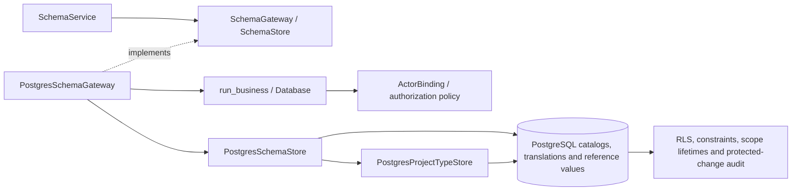

# PostgreSQL schema settings

`SchemaService` now executes complete callbacks through `PostgresSchemaGateway`.
The callback includes authorization, reference checks, automatic identifier/order
selection, and the resulting writes. Each attempt uses the existing signed actor
binding and the common transaction runner: repeatable-read snapshots for reads,
serializable writes, and at most three attempts after definite serialization or
deadlock rollbacks. No new migration or allocation lock is required for this port.

## Preserved behavior

- Group creation keeps unique names and display orders. Automatic order selection
  fills gaps; competing automatic creates recalculate their order on retry.
- Property creation allocates stable `PRM_` identifiers or accepts an explicit ID.
  Definition, selected project types and initial choices commit together. Scope
  changes retain their existing semantics through `PostgresProjectTypeStore` on
  the same connection. Initial choices and selected type IDs are copied before
  callbacks, and generated IDs are recalculated from each attempt's snapshot.
- Definitions and options are protected by scalar and list references in project
  values and template defaults. An explicit null value still protects the property
  against deletion or a type change. Duplicate choices retain distinct identities.
- Group deletion detaches its definitions without removing values. Property
  deletion removes its choices atomically; a parent failure restores both choices
  and protected-change audit state.
- Localized aliases use the translation table, normalize locale codes and remove
  blank translations. They do not modify stable property IDs or default labels.
  Nullable stored mandatory flags retain the existing false display value.
- Catalog lists use explicit projections and native booleans. Groups and choices
  follow display order; definitions use deterministic binary identifier order.

Schema administration requires `business.manage`. Authorized project readers can
request only the existing property/alias reference contracts through the service.
Permanent database policies and mutation guards also reject unauthorized direct
updates, deletes and translation upserts. Option deletion and enum retyping reuse
the native grant invalidation and scope-property tombstone triggers; recreating
an option label or changing the property back to ENUM does not revive old grants.

## C3: components



Application composition injects the native gateway with the shared restricted
pool and current actor. The former SQLite callback bridge is archived outside
the runtime; there is no SQLite SQL adapter or fallback.

## Validation

The existing schema, schema UI, scoped schema UI, template, translation and layer
regressions passed **47 checks in 19.21 seconds**. Output:
`.local/postgresql-schema-legacy.log`.

Native tests use fresh PostgreSQL databases and actual restricted runtime
connections. They cover CRUD and nullable flags, translations, compound rollback,
project/default reference guards, preserved stored values, safe error handling,
authorization including direct SQL attempts, categorical lifetimes, and consistent
multi-query snapshots. Concurrency checks establish overlapping snapshots and
observe whole-callback retry. They include an automatic create committed after a
competing snapshot was opened, and service-level option deletion versus template
default creation. A forced definite rollback verifies that mutated caller lists
do not replace the original submitted choices or type membership.

The broader verification command is:

```powershell
.venv/Scripts/python.exe -m dotenv -f .local/postgresql.env run -- .venv/Scripts/python.exe -m pytest -q --tb=short -p no:cacheprovider tests/postgresql/test_schema.py tests/postgresql/test_project_types.py tests/postgresql/test_scope_resolution.py tests/postgresql/test_business_security.py tests/postgresql/test_foundation.py --cov=app.infrastructure.postgresql.schema --cov=app.application.services.schema --cov-report=term-missing --cov-report=json:.local/postgresql-schema-coverage.json
```

Output: `.local/postgresql-schema-native.log`. Subsystem results are recorded in
[migration evidence](postgresql-migration-evidence.md). These checks do not prove
the pending full-codebase coverage, representative deployed recovery or 50-user
browser performance gates. Runtime cutover is implemented separately in the
[native runtime guide](postgresql-runtime.md).
