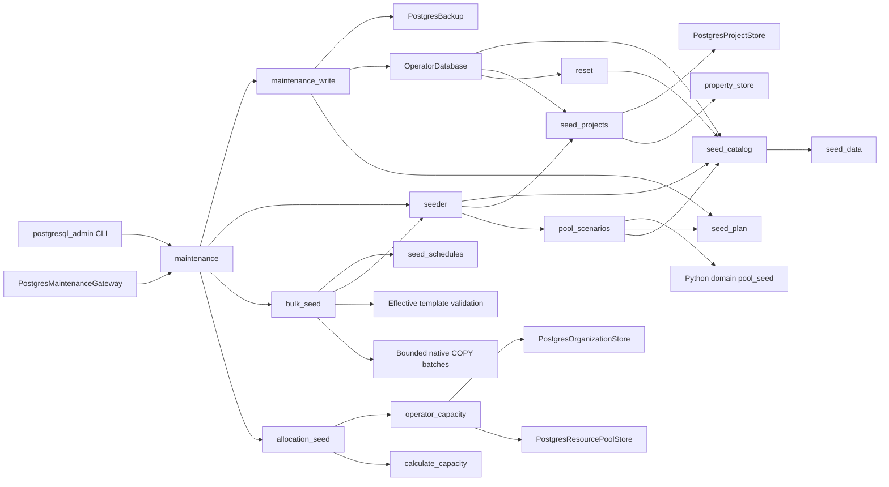

# PostgreSQL operator seeding and reset

Generated portfolios use 10% Completed, at most 5% Cancelled, 4% Draft, and 3%
On Hold; all remaining projects are In Progress. Each percentage is rounded down
to whole projects, so a five-project sample is entirely In Progress. The mix is
shuffled deterministically by the requested seed. Completed task schedules shift
as a whole to finish no later than yesterday, retaining task durations and links.
The operator freezes the current date before a replayable seed transaction.

Default and full project seeds include `p.1.10` through `p.10.10`, with descriptions
`descripttion projet 1` through `descripttion projet 10`. The additional fictive WBS
`xx.xx.xx` is stored as `#xx.xx.xx` using the existing fictive-code convention,
with description `otp fictif pour plannification`. Missing entries are inserted;
existing identities, edited descriptions and unrelated entries are retained.
The seed also installs project roles `maintenance`, `bim`, `amo`, `etudes`, and
`secutite`. WBS percentages are not automatically assigned to projects.

Native default/demo and bulk seeding, pool replacement and allocation generation
use explicit backed-up operator transactions. Ordinary startup does not seed.
No schema migration is needed for the Ressort A seed change.

Historical initial fixture, before the monthly variability change: applied on 2026-09-14 after a verified custom-format backup
in `data/backups/postgresql/`. Verification found 1,000 projects, 7,336 tasks and
6,583 dependencies preserved; 900 projects allocated, 100 unallocated, 33 pools,
seven groups and 24,038 dated assignment segments. The capacity calculator
confirmed 7 overallocated, 4 underallocated and 22 fully allocated pools, with a
150% peak. Hashes of unrelated business/account/financial tables matched; normal
activity in the open login session was excluded from exact session-row matching.
The Settings hierarchy and allocation displays were inspected in Chrome.

Validation passed 93 focused seed/form tests, 33 operator/archive tests, and 13
fixture/architecture checks. Both the Python seed planner and PostgreSQL pool
plan module reached 100% statement coverage. Append-after-catalog installation
also has a real PostgreSQL regression check. Historical multi-user performance
acceptance was not rerun.

Existing project definitions retain 31 properties, five property groups, five
project types, 60 functions, 50 employees and three teams. Default installation
retains five projects, 15 tasks and 14 dependencies, and creates the same pool
hierarchy as fresh bulk seeds. Catalog-only installation creates the hierarchy
without demand. Custom populated catalogs remain unchanged unless explicitly reset.

### Ressort A layout

| Parent | Children | Hierarchy type | Configured/effective FTE |
|---|---|---|---|
| Root | Ressort A | ressort | group |
| Ressort A | Service E, G, I, M, P | service | groups |
| Service P | pool BIM, pool Tech | division | 10 each |
| Service P | Projets | division | group |
| Projets | team A?H, team J, team K | equipe | 4 each |
| Service I | pool I1?I6 | division | 3, 5, 8, 12, 16, 20 |
| Service E/G/M | pool E1?E5 / G1?G5 / M1?M5 | division | 5, 6, 7, 8, 10 per service |

There are exactly seven groups and 33 pools. No employee, function or team
mappings are generated, so nominal capacity equals configured capacity.
Missing required hierarchy codes and translations are created through the
existing reference tables; existing labels are preserved.

After calculating and inserting assignments, every pool receives one to three
six-month capacity exceptions, each reducing capacity by 1 FTE. Pools whose
nominal capacity is strictly above 6 FTE also receive two additional twelve-month
exceptions, each reducing capacity by 1 FTE. Periods cover complete calendar
months spread reproducibly over five years from the seed year. Overlapping
reductions add together using the existing capacity rules. Assignments are not
recalculated, so the original nominal-capacity allocation limits remain intact.
Existing pool installations are preserved unless replacement is requested.

### Demo WBS budgets

Fresh demo/catalog seeding creates one sealed Approved Finance version named
`Demo WBS budgets — ten-year plans`. Each of `p.1.10` through `p.10.10` totals
between €5 million and €10 million over ten consecutive years. Start years are
2020 for p1/p2, 2021 for p3/p4, 2022 for p5/p6, 2024 for p7/p8, and 2025 for p9/p10.
Annual amounts follow a discrete Gaussian curve centered between years five and
six, with standard deviation two years. Decimal arithmetic and largest-remainder
cent allocation preserve exact totals.

The seeder also creates a sealed Proposed version linked to that Approved
version. A reproducible variation between -10% and +10% is selected per WBS
and applied across its ten years. Decimal cent rounding stays within the limits
for every annual amount and therefore for each WBS total. Existing Approved
amounts are reused when adding a missing Proposed version; repeated seeding
preserves both snapshots instead of overwriting Finance history.

For a full generation, eligible projects have status `In Progress` and are ordered
by ID. The first gets 100% of p.1.10; the second gets 100% of p.2.10 and 50% of
p.3.10. The remaining 50% of p.3.10 and all of p.4.10–p.10.10 are distributed in
25% increments across the next ten projects. Each WBS totals 100% when all twelve
projects exist; with fewer projects, unused shares remain unallocated. Other
statuses are excluded. The initial five-project sample follows the same rule.

Finance history is retained, and an existing demo budget version is reused.
Append-seeding does not assign additional WBS shares or redistribute existing ones.

### Resource assignment periods

`app/domain/resources/pool_seed.py` owns layout and demand planning in Python.
Projects are processed in ascending ID order. The first 25% (rounded up) use
project-level assignments and can consume up to half of each pool's configured
allocation ceiling. Remaining projects use task-level assignments against the
other half. Unused capacity in one half is not transferred to the other.

Each project-level project receives one pool slot. Each task-level project receives
one slot per dated task, ordered by task ID. Slots are between 0.1 and 5 FTE in
0.1 increments and cover the complete inherited project/task period. No custom
assignment dates, monthly slices, or offset schedules are stored. Projects without
dated tasks remain unallocated. If any task in a project cannot fit, all provisional
slots for that project are released and the project remains unallocated. Later IDs
can reuse capacity in nonoverlapping periods.

The existing utilization categories remain: seven high-demand pools may reach
180%, four underallocated pools are capped at 75%, E1/E2 remain capped at 80%,
and other pools are capped at 100%. Capacity is checked across every overlapping
assignment boundary, separately for each reserved half. Actual utilization varies
with project/task schedules; there are no artificial monthly peaks. The seed controls
pool selection and slot amounts, but never shuffles project processing order.
Unallocated counts now follow available slots rather than a fixed 10% quota.

Append operations do not change or rebalance existing allocations, and newly
appended projects remain unallocated. Ordinary repeated seeding is a no-op for
an installed layout. An explicit refresh is required to change allocations.

Migration 0019 adds private installation markers for reference and demo seeds.
Initial hierarchy choices remain optional and editable, with stable codes and
translation rows. Subsequent initialization preserves removed or renamed
choices. Existing populated demo catalogs are detected before installation.
The runtime role has no access to installation markers.

Curated projects retain their templates, defaults and required-property
validation. Five projects have exact planned budgets totaling 1,250,000 euros
and actual budgets totaling 842,000 euros, with 15 tasks and 14 dependency
edges. Monetary inputs use `Decimal`; operator identity allocation does not
bypass the signed-actor requirement on the runtime allocator.

Reset removes dependency edges and tasks before projects, keeping native
constraints enabled. Full reset additionally clears demo references and restores
the General type and default event choices. Accounts, grants, audit history,
approved financial plans and configured hierarchy choices remain intact.
Project/task identity sequences retain their high-water marks, including
explicit operator IDs. Unlike SQLite's sequence reset, this prevents a newly
seeded object from reusing a deleted object's identity. Deleted scope targets
also retain the existing native grant invalidation behavior.

`backed_up_write` creates one PostgreSQL archive outside the replayable write
callback, then rechecks the prepared business-source fingerprint on every
attempt. Failed archives prevent all writes. Changed sources abort the command;
serialization failures may replay database work, but neither an external archive
nor an uncertain commit is replayed. The maintenance gateway must call this
boundary; low-level transaction helpers are not standalone reset commands.

Pool preparation reads a repeatable-read snapshot and freezes parameterized
commands. Preview never consumes identities or writes rows. `seed-pools --replace`
previews removal counts, hierarchy/types/capacities, project coverage, utilization
categories and peak utilization. Add `--apply` to create a complete archive and
execute the plan. Existing layouts require explicit replacement; ordinary seeding
never silently replaces them.

Replacement deletes pool assignments, mappings, memberships, pool tags and pool
owners in one transaction; derived pool capacity calendars/caches cascade with
their owners. Employee calendars are unrelated and remain intact. Projects, tasks,
people, accounts and financial records are preserved. Identity sequences are
never reset. Failed backups, stale sources and transaction failures leave the
existing data intact (sequences may advance after a rolled-back write).

Prepared identities are provisional until the transaction commits; source
fingerprints include database incarnation, all project/pool generations, the
shared catalog and installation markers. Native uniqueness constraints also
remain active. Nontransactional sequence advances caused by a rolled-back
attempt do not invalidate its own replay. Authentication activity, retained
financial history and derived caches are not seed inputs.

## C3 — Components



Native PostgreSQL tests cover installed relationships, configurable references,
existing catalogs, template validation, exact euros, dependency ownership,
identity allocation and reset retention. Run with the explicit local operator
and runtime configuration:

```powershell
.venv/Scripts/python.exe -m dotenv -f .local/postgresql.env run -- .venv/Scripts/python.exe -m pytest -q --tb=short -p no:cacheprovider tests/postgresql/test_seed_catalog.py tests/postgresql/test_seed_projects_reset.py tests/postgresql/test_integrity.py tests/test_layer_boundaries.py
```

Additional native scenario and archive tests prove read-only previews, explicit atomic
replacement, rollback, fresh-source checks on retries and restoration of the
actual pre-reset/pre-seed archive. PostgreSQL clients must be installed; tests
can instead use the isolated server container as documented in
[PostgreSQL backups](postgresql-backups.md).

```powershell
.venv/Scripts/python.exe -m dotenv -f .local/postgresql.env run -- .venv/Scripts/python.exe -m pytest -q --tb=short -p no:cacheprovider tests/postgresql/test_pool_seed_scenarios.py tests/postgresql/test_maintenance_write.py tests/postgresql/test_backups.py
```

## Explicit operator commands

Apply migrations first. These commands check schema compatibility and use the
separately supplied `DATABASE_OPERATOR_URL`; `--url-variable` can name another
explicit operator connection. The client process needs native PostgreSQL clients
and network access to the selected URL. Archive storage follows the policy in
[PostgreSQL backups](postgresql-backups.md).

```powershell
.venv/Scripts/python.exe -m scripts.postgresql_admin --env-file .local/postgresql.env seed-defaults
.venv/Scripts/python.exe -m scripts.postgresql_admin --env-file .local/postgresql.env seed-pools --year 2026 --replace
.venv/Scripts/python.exe -m scripts.postgresql_admin --env-file .local/postgresql.env seed-pools --year 2026 --replace --apply
.venv/Scripts/python.exe -m scripts.postgresql_admin --env-file .local/postgresql.env generate-allocations
.venv/Scripts/python.exe -m scripts.postgresql_admin --env-file .local/postgresql.env counts
.venv/Scripts/python.exe -m scripts.postgresql_admin --env-file .local/postgresql.env clear-allocations
.venv/Scripts/python.exe -m scripts.postgresql_admin --env-file .local/postgresql.env reset
```

`seed-defaults --without-projects` installs only the default catalog.
`seed-defaults --force` performs the full reference reset and demo installation
under one pre-operation archive. `reset --all-references` clears the demo
references as well as projects; it still retains accounts, finance history and
hierarchy choices. `seed-pools` previews by default; `--apply` requests the
backed-up mutation and `--seed` selects its reproducible random seed.

No-op default/scenario installation and previews create no archive. Mutating
commands create one archive even when they invoke nested catalog/scenario
helpers. `clear-allocations` removes demand while preserving resource mappings.
The retained maintenance wrappers now use these native entry points with
explicit operator configuration. See [runtime and command setup](postgresql-runtime.md).

## Bulk projects and schedules

```powershell
.venv/Scripts/python.exe -m scripts.postgresql_admin --env-file .local/postgresql.env seed-projects --projects 10001 --min-tasks 0 --max-tasks 15 --seed 42
```

Bulk generation resets projects and demo references by default, with one
pre-operation archive. `--append` preserves existing records and uses the current
templates, property options and organization. It does not inject a demo
organization into a custom catalog. Only newly generated rows receive cyclic
tags. Append operations leave all allocations unchanged; new projects remain
unallocated until an explicit refresh. Counts are validated before backup; zero projects
and task limits from zero through 50 retain their existing meanings.

The native generator reads template definitions, membership, required rules,
defaults and choices in batches. It applies the same domain validation as
interactive project creation. Seeded euro amounts use Decimal arithmetic and
the existing two-decimal, ties-to-even convention. Phases, milestones, extra
work packages, progress distributions and earlier-project dependencies retain
the original random draw order. An unspecified random seed is selected once
before entering a callback and reused on every retry.

Psycopg sends at most 500 rows per COPY statement, with all native constraints,
authorization guards and revision triggers enabled. Actual task IDs are reserved
from PostgreSQL and substituted into dependency edges; another task inserted
between reservation and COPY receives a distinct ID. Healthy sequences are not
reset. Repair of an explicit operator ID beyond a sequence takes a table lock
before advancing it, preventing normal inserts from racing with setval. Reset
uses the same project-creation identity lock as operator/runtime creation.

The committed `tests/postgresql/fixtures/bulk_seed_golden.json` contains hashes
from independently generated synthetic baseline databases. Four workloads cover
mixed schedules, single phases, 50-task projects and an empty seed. The native
regressions compare project budgets/metadata, typed properties, selection order,
task dates/progress and dependency records. No SQLite data is imported and no
SQLite runtime dependency is required by these golden tests.

A fresh isolated 10,001-project workload completed in **24.68 seconds**, including
its one archive, with **73,929 tasks**, **66,173 dependencies**, **258,022 property
values** and **10,201 allocations**. These match the accepted benchmark workload.
The [recorded counts and timing](postgresql-bulk-seed-scale.json) validate operator
generation. The authenticated 50-user browser acceptance gate remains separate
and must be run after runtime cutover.

## Configurable allocation mixes

`generate-allocations` previews the requested pool usage and staffing mix. It
accepts `--allocated-pools`, `--average-allocation`, `--overallocated-pools`,
`--max-overallocation`, `--underallocated-pools`, `--unstaffed-pools` and `--seed`.
The meanings and validation remain those of Database Seeding: average usage
applies to selected pools, and maximum overallocation is excess above 100%.

The preview reads one repeatable-read snapshot with the separate operator
connection. It simulates mapping repairs and demand in memory using the existing
domain capacity calculations. It does not write rows, consume sequence values,
or create an archive. Employee calendars remain inclusive, team/function/direct
mapping precedence is preserved, adjacent equal-capacity days are merged, and
zero-capacity periods receive no demand. FTE values retain the existing 0.001
precision and category checks.

Add `--apply` to archive the database once and apply the frozen mutations in a
serializable transaction. An optional `--expected-fingerprint` supplies the source
fingerprint from a reviewed preview. Source changes invalidate that review;
changes during archiving or between transaction attempts also reject the write.
Only retryable PostgreSQL failures replay the database callback, using the same
plan and the original archive. Foreign keys and revision triggers stay enabled.
A failed mutation rolls back demand deletion, staffing changes and new demand.

Unstaffed pools have their mappings removed and receive a theoretical capacity
when needed. Other pools keep usable employee/team staffing; repairs reuse a
matching zero-percent employee mapping or add a positive employee. Applying a
zero-allocation request still clears existing demand. Impossible capacity mixes
fail before an archive or write.

Bulk project seeding refreshes PostgreSQL planner statistics for the application
schema before its transaction completes. This prevents the first large planning
read from depending on a later automatic analyze. Both initial generation and
append use this preparation; the existing single archive and atomic write policy
remain in force. Runtime requests do not run `ANALYZE`.

This addresses a reproduced 10-second planning-summary statement timeout on the
10,001-project fixture. Explicitly refreshing statistics in the isolated pilot
allowed the same full planning view to open in 5.799 seconds without a SQL timeout.
That is cold-load evidence, not the one-second warm responsiveness target. A real
PostgreSQL regression disables automatic analysis on the test's selected tables
and verifies current row estimates immediately after initial and appended seeds.
The seed, archive/transaction, maintenance-gateway, load-report and import-boundary
checks passed **58 tests in 42.09 seconds** in
`.local/postgresql-seed-statistics-validation.log`.

`PostgresMaintenanceGateway` implements the complete `MaintenanceGateway` port.
The native CLI routes seeds, allocation generation, resets and counts through
`MaintenanceService`. Its explicit operator initialization applies migrations
and initial references; constructing the gateway performs no I/O. This is not
application startup. The launcher now uses the restricted PostgreSQL runtime
pool; retained maintenance wrappers use separate native operator credentials.

The allocation regressions restore a real pre-operation archive, check native
actor-bound capacity and employee privacy, and compare complete report/mutation
hashes against four independently generated synthetic legacy fixtures in
`tests/postgresql/fixtures/allocation_seed_golden.json`. These golden tests use
PostgreSQL only and import no existing business data.

```powershell
.venv/Scripts/python.exe -m dotenv -f .local/postgresql.env run -- .venv/Scripts/python.exe -m pytest -q --tb=short -p no:cacheprovider tests/postgresql/test_allocation_seed.py tests/postgresql/test_allocation_seed_golden.py tests/postgresql/test_maintenance_gateway.py
```
