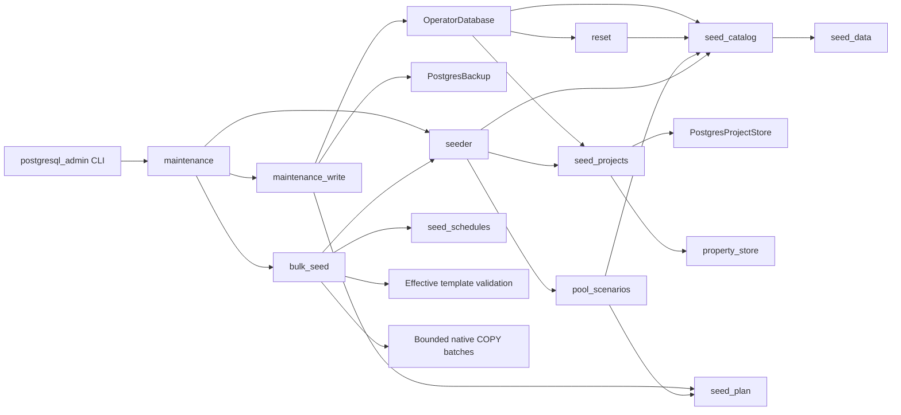

# PostgreSQL operator seeding and reset

Status: native default/demo and bulk project seeding, reset, scenario previews
and backed-up operator CLI commands implemented. Allocation generation and the remaining
maintenance-service integration are in progress. These helpers use explicit operator transactions;
ordinary application startup must not call them.

The accepted fixed demo definitions are Python literals in `seed_data.py`.
They preserve 31 project properties, five groups, five project types, 60
functions, 50 employees, three teams and three initial resource pools. This
copies repository definitions, not existing SQLite business or account data.

Complete default installation includes dictionary tags, four sample allocations
and the hierarchy scenarios: five projects, 15 tasks, 14 dependencies, 103 pools,
31 pool groups, 307 resource mappings and 204 allocations. Catalog-only seeding
omits projects and scenarios while retaining the three base pools. A populated
catalog remains unchanged unless forced; missing initial reference choices are
installed separately without injecting a demo organization into a custom catalog.

Migration 0019 adds private installation markers for reference and demo seeds.
Initial hierarchy choices remain optional and editable, with stable codes and
translation rows. Subsequent initialization preserves removed or renamed
choices. Existing populated demo catalogs are detected before installation.
The runtime role has no access to installation markers.

Curated projects retain their templates, defaults and required-property
validation. Five projects have exact planned budgets totaling 1,250,000 euros
and actual budgets totaling 842,000 euros, with 15 tasks and 14 dependency
edges. Monetary inputs use `Decimal`; operator identity allocation does not
bypass the signed-actor requirement on the runtime allocator.

Reset removes dependency edges and tasks before projects, keeping native
constraints enabled. Full reset additionally clears demo references and restores
the General type and default event choices. Accounts, grants, audit history,
approved financial plans and configured hierarchy choices remain intact.
Project/task identity sequences retain their high-water marks, including
explicit operator IDs. Unlike SQLite's sequence reset, this prevents a newly
seeded object from reusing a deleted object's identity. Deleted scope targets
also retain the existing native grant invalidation behavior.

`backed_up_write` creates one PostgreSQL archive outside the replayable write
callback, then rechecks the prepared business-source fingerprint on every
attempt. Failed archives prevent all writes. Changed sources abort the command;
serialization failures may replay database work, but neither an external archive
nor an uncertain commit is replayed. The maintenance gateway must call this
boundary; low-level transaction helpers are not standalone reset commands.

Pool scenario preparation reads a repeatable-read snapshot and produces frozen
parameterized inserts. Preview never consumes identities or writes temporary
rows into the live database. The accepted layout remains five units and four
staffing scenarios per Service root: a fresh demo creates 25 units, 100 pools,
300 employee mappings and up to 100 project plus 100 task assignments. Existing
projects and schedules remain unchanged; repeated installation is a no-op.
Legacy scenario markers, insufficient employees and generated name collisions
are rejected during preview.

Prepared identities are provisional until the transaction commits; source
fingerprints include database incarnation, all project/pool generations, the
shared catalog and installation markers. Native uniqueness constraints also
remain active. Nontransactional sequence advances caused by a rolled-back
attempt do not invalidate its own replay. Authentication activity, retained
financial history and derived caches are not seed inputs.

## C3 — Components



Native PostgreSQL tests cover installed relationships, configurable references,
existing catalogs, template validation, exact euros, dependency ownership,
identity allocation and reset retention. Run with the explicit local operator
and runtime configuration:

```powershell
.venv/Scripts/python.exe -m dotenv -f .local/postgresql.env run -- .venv/Scripts/python.exe -m pytest -q --tb=short -p no:cacheprovider tests/postgresql/test_seed_catalog.py tests/postgresql/test_seed_projects_reset.py tests/postgresql/test_integrity.py tests/test_layer_boundaries.py
```

Additional native scenario and archive tests prove read-only previews, additive
application, rollback, fresh-source checks on retries and restoration of the
actual pre-reset/pre-seed archive. PostgreSQL clients must be installed; tests
can instead use the isolated server container as documented in
[PostgreSQL backups](postgresql-backups.md).

```powershell
.venv/Scripts/python.exe -m dotenv -f .local/postgresql.env run -- .venv/Scripts/python.exe -m pytest -q --tb=short -p no:cacheprovider tests/postgresql/test_pool_seed_scenarios.py tests/postgresql/test_maintenance_write.py tests/postgresql/test_backups.py
```

## Explicit operator commands

Apply migrations first. These commands check schema compatibility and use the
separately supplied `DATABASE_OPERATOR_URL`; `--url-variable` can name another
explicit operator connection. The client process needs native PostgreSQL clients
and network access to the selected URL. Archive storage follows the policy in
[PostgreSQL backups](postgresql-backups.md).

```powershell
.venv/Scripts/python.exe -m scripts.postgresql_admin --env-file .local/postgresql.env seed-defaults
.venv/Scripts/python.exe -m scripts.postgresql_admin --env-file .local/postgresql.env seed-pools --year 2026
.venv/Scripts/python.exe -m scripts.postgresql_admin --env-file .local/postgresql.env seed-pools --year 2026 --apply
.venv/Scripts/python.exe -m scripts.postgresql_admin --env-file .local/postgresql.env counts
.venv/Scripts/python.exe -m scripts.postgresql_admin --env-file .local/postgresql.env clear-allocations
.venv/Scripts/python.exe -m scripts.postgresql_admin --env-file .local/postgresql.env reset
```

`seed-defaults --without-projects` installs only the default catalog.
`seed-defaults --force` performs the full reference reset and demo installation
under one pre-operation archive. `reset --all-references` clears the demo
references as well as projects; it still retains accounts, finance history and
hierarchy choices. `seed-pools` previews by default; `--apply` requests the
backed-up mutation and `--seed` selects its reproducible random seed.

No-op default/scenario installation and previews create no archive. Mutating
commands create one archive even when they invoke nested catalog/scenario
helpers. `clear-allocations` removes demand while preserving resource mappings.
The existing application launcher and legacy maintenance wrappers have not yet
cut over to these native entry points.

## Bulk projects and schedules

```powershell
.venv/Scripts/python.exe -m scripts.postgresql_admin --env-file .local/postgresql.env seed-projects --projects 10001 --min-tasks 0 --max-tasks 15 --seed 42
```

Bulk generation resets projects and demo references by default, with one
pre-operation archive. `--append` preserves existing records and uses the current
templates, property options and organization. It does not inject a demo
organization into a custom catalog. Only newly generated rows receive cyclic
tags and pool assignments. Counts are validated before backup; zero projects
and task limits from zero through 50 retain their existing meanings.

The native generator reads template definitions, membership, required rules,
defaults and choices in batches. It applies the same domain validation as
interactive project creation. Seeded euro amounts use Decimal arithmetic and
the existing two-decimal, ties-to-even convention. Phases, milestones, extra
work packages, progress distributions and earlier-project dependencies retain
the original random draw order. An unspecified random seed is selected once
before entering a callback and reused on every retry.

Psycopg sends at most 500 rows per COPY statement, with all native constraints,
authorization guards and revision triggers enabled. Actual task IDs are reserved
from PostgreSQL and substituted into dependency edges; another task inserted
between reservation and COPY receives a distinct ID. Healthy sequences are not
reset. Repair of an explicit operator ID beyond a sequence takes a table lock
before advancing it, preventing normal inserts from racing with setval. Reset
uses the same project-creation identity lock as operator/runtime creation.

The committed `tests/postgresql/fixtures/bulk_seed_golden.json` contains hashes
from independently generated synthetic baseline databases. Four workloads cover
mixed schedules, single phases, 50-task projects and an empty seed. The native
regressions compare project budgets/metadata, typed properties, selection order,
task dates/progress and dependency records. No SQLite data is imported and no
SQLite runtime dependency is required by these golden tests.

A fresh isolated 10,001-project workload completed in **24.68 seconds**, including
its one archive, with **73,929 tasks**, **66,173 dependencies**, **258,022 property
values** and **10,201 allocations**. These match the accepted benchmark workload.
The [recorded counts and timing](postgresql-bulk-seed-scale.json) validate operator
generation. The authenticated 50-user browser acceptance gate remains separate
and must be run after runtime cutover.
