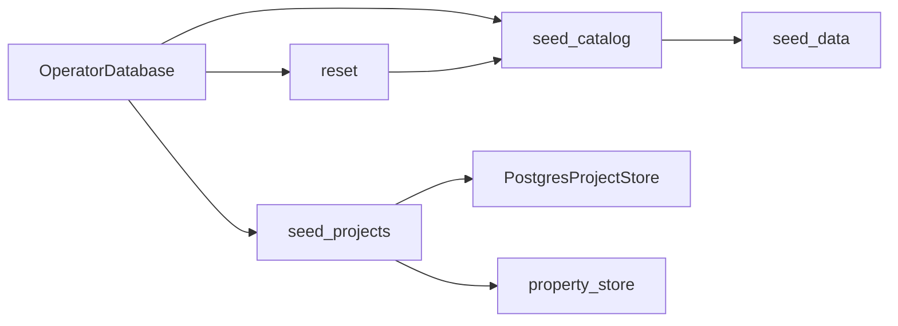

# PostgreSQL operator seeding and reset

Status: native catalog, curated project and reset helpers implemented. The
maintenance gateway, bulk generation, scenario previews and CLI integration
remain in progress. These helpers run only on an explicit operator transaction;
ordinary application startup must not call them.

The accepted fixed demo definitions are Python literals in `seed_data.py`.
They preserve 31 project properties, five groups, five project types, 60
functions, 50 employees, three teams and three initial resource pools. This
copies repository definitions, not existing SQLite business or account data.

Migration 0019 adds private installation markers for reference and demo seeds.
Initial hierarchy choices remain optional and editable, with stable codes and
translation rows. Subsequent initialization preserves removed or renamed
choices. Existing populated demo catalogs are detected before installation.
The runtime role has no access to installation markers.

Curated projects retain their templates, defaults and required-property
validation. Five projects have exact planned budgets totaling 1,250,000 euros
and actual budgets totaling 842,000 euros, with 15 tasks and 14 dependency
edges. Monetary inputs use `Decimal`; operator identity allocation does not
bypass the signed-actor requirement on the runtime allocator.

Reset removes dependency edges and tasks before projects, keeping native
constraints enabled. Full reset additionally clears demo references and restores
the General type and default event choices. Accounts, grants, audit history,
approved financial plans and configured hierarchy choices remain intact.
Project/task identity sequences retain their high-water marks, including
explicit operator IDs. Unlike SQLite's sequence reset, this prevents a newly
seeded object from reusing a deleted object's identity. Deleted scope targets
also retain the existing native grant invalidation behavior.

The eventual maintenance gateway must own a pre-operation PostgreSQL archive
outside the replayable write callback. These transaction helpers do not create
backups themselves and are not exposed as standalone reset commands.

## C3 — Components



Native PostgreSQL tests cover installed relationships, configurable references,
existing catalogs, template validation, exact euros, dependency ownership,
identity allocation and reset retention. Run with the explicit local operator
and runtime configuration:

```powershell
.venv/Scripts/python.exe -m dotenv -f .local/postgresql.env run -- .venv/Scripts/python.exe -m pytest -q --tb=short -p no:cacheprovider tests/postgresql/test_seed_catalog.py tests/postgresql/test_seed_projects_reset.py tests/postgresql/test_integrity.py tests/test_layer_boundaries.py
```
