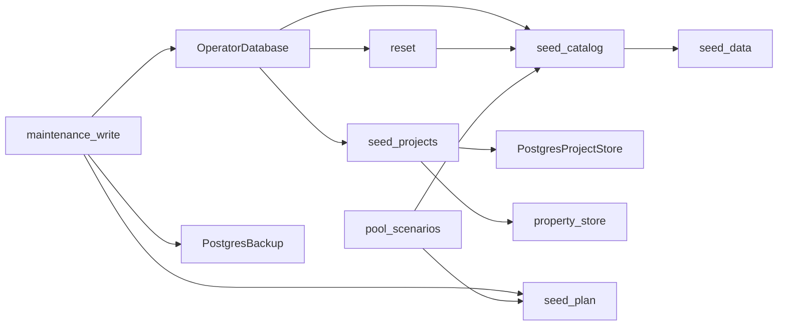

# PostgreSQL operator seeding and reset

Status: native catalogs, curated projects, reset, scenario previews and backed-up
write orchestration implemented. The maintenance gateway, bulk/allocation
generation and CLI integration remain in progress. These helpers use explicit operator transactions;
ordinary application startup must not call them.

The accepted fixed demo definitions are Python literals in `seed_data.py`.
They preserve 31 project properties, five groups, five project types, 60
functions, 50 employees, three teams and three initial resource pools. This
copies repository definitions, not existing SQLite business or account data.

Migration 0019 adds private installation markers for reference and demo seeds.
Initial hierarchy choices remain optional and editable, with stable codes and
translation rows. Subsequent initialization preserves removed or renamed
choices. Existing populated demo catalogs are detected before installation.
The runtime role has no access to installation markers.

Curated projects retain their templates, defaults and required-property
validation. Five projects have exact planned budgets totaling 1,250,000 euros
and actual budgets totaling 842,000 euros, with 15 tasks and 14 dependency
edges. Monetary inputs use `Decimal`; operator identity allocation does not
bypass the signed-actor requirement on the runtime allocator.

Reset removes dependency edges and tasks before projects, keeping native
constraints enabled. Full reset additionally clears demo references and restores
the General type and default event choices. Accounts, grants, audit history,
approved financial plans and configured hierarchy choices remain intact.
Project/task identity sequences retain their high-water marks, including
explicit operator IDs. Unlike SQLite's sequence reset, this prevents a newly
seeded object from reusing a deleted object's identity. Deleted scope targets
also retain the existing native grant invalidation behavior.

`backed_up_write` creates one PostgreSQL archive outside the replayable write
callback, then rechecks the prepared business-source fingerprint on every
attempt. Failed archives prevent all writes. Changed sources abort the command;
serialization failures may replay database work, but neither an external archive
nor an uncertain commit is replayed. The maintenance gateway must call this
boundary; low-level transaction helpers are not standalone reset commands.

Pool scenario preparation reads a repeatable-read snapshot and produces frozen
parameterized inserts. Preview never consumes identities or writes temporary
rows into the live database. The accepted layout remains five units and four
staffing scenarios per Service root: a fresh demo creates 25 units, 100 pools,
300 employee mappings and up to 100 project plus 100 task assignments. Existing
projects and schedules remain unchanged; repeated installation is a no-op.
Legacy scenario markers, insufficient employees and generated name collisions
are rejected during preview.

Prepared identities are provisional until the transaction commits; source
fingerprints include database incarnation, all project/pool generations, the
shared catalog and installation markers. Native uniqueness constraints also
remain active. Nontransactional sequence advances caused by a rolled-back
attempt do not invalidate its own replay. Authentication activity, retained
financial history and derived caches are not seed inputs.

## C3 — Components



Native PostgreSQL tests cover installed relationships, configurable references,
existing catalogs, template validation, exact euros, dependency ownership,
identity allocation and reset retention. Run with the explicit local operator
and runtime configuration:

```powershell
.venv/Scripts/python.exe -m dotenv -f .local/postgresql.env run -- .venv/Scripts/python.exe -m pytest -q --tb=short -p no:cacheprovider tests/postgresql/test_seed_catalog.py tests/postgresql/test_seed_projects_reset.py tests/postgresql/test_integrity.py tests/test_layer_boundaries.py
```

Additional native scenario and archive tests prove read-only previews, additive
application, rollback, fresh-source checks on retries and restoration of the
actual pre-reset/pre-seed archive. PostgreSQL clients must be installed; tests
can instead use the isolated server container as documented in
[PostgreSQL backups](postgresql-backups.md).

```powershell
.venv/Scripts/python.exe -m dotenv -f .local/postgresql.env run -- .venv/Scripts/python.exe -m pytest -q --tb=short -p no:cacheprovider tests/postgresql/test_pool_seed_scenarios.py tests/postgresql/test_maintenance_write.py tests/postgresql/test_backups.py
```
