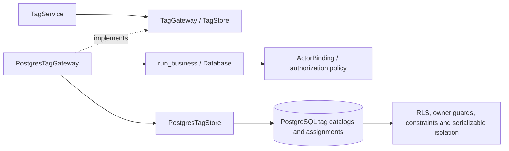

# PostgreSQL tags

`TagService` now uses whole-operation callbacks through `PostgresTagGateway`.
The native store implements tag groups, dictionary entries, project/task/pool
assignments, batched links, and paged task-tag queries. Application composition
injects the native gateway; the former SQLite callback bridge is archived.
This adapter port required no additional SQL migration.

## Behavior and authorization

Catalog management and resource-pool tagging require shared business management.
Project readers can use the existing minimal dictionary/entity selectors and
read assignments within their project scope. Native row policies filter project
and task assignments before joins, usage totals, filters, ordering and paging.
Mutation guards enforce edit permission on both the old and requested owners of
an assignment. Invisible assignments remain absent and cannot be moved or deleted.

The service preserves cross-group dictionary assignments, combined dictionary
and free-form tags, normalized labels, optional groups and existing missing-ID
results. Group deletion checks dictionary references in the same transaction.
Dictionary deletion removes all three assignment kinds atomically; a failed
parent delete restores every earlier assignment delete.

Pool assignments remain unique by `(pool_id, tag_id)`. An explicit native upsert
returns the same identity for concurrent duplicate submissions. Its authorization
guards still run; definite conflicts replay the complete authorized callback.
Normalized dataclass commands, pool assignment inputs, batch ID lists and filter
maps are copied before starting a callback so retries preserve submitted inputs.

## Query contracts

Catalog queries use explicit typed projections. Dictionary usage counts aggregate
policy-visible assignment rows before joining labels. Project/task link loaders
use one array-bound query, return links in assignment-ID order and retain empty
lists for requested IDs without visible links. They do not discover or return
additional hidden IDs.

Task-tag pages read total count, filtered count and one page in a single
repeatable-read snapshot. Page sizes remain between 1 and 200. Selector searches
remain bounded to 1–100 rows and support exact `#ID` lookups. Literal substring
search treats `%`, `_` and SQL-looking text as data. Sort/filter expressions come
only from an internal allowlist. Case conversion uses the `C` collation to retain
the existing ASCII case-insensitive behavior; numeric IDs sort numerically, null
placement matches the existing UI and assignment IDs break text-sort ties.

## C3: components



## Validation

The affected existing tag, paging, UI and layer checks passed **49 checks in
10.67 seconds**. Output: `.local/postgresql-tags-legacy.log`.

Native checks use fresh PostgreSQL databases and restricted runtime credentials.
They cover typed CRUD and counts, selectors, compound deletion rollback, hidden
rows across reads/counts/pages/batches, old/new owner checks, literal searches,
bounded queries, numeric/text/null sort behavior, snapshot consistency during a
concurrent deletion, safe outages, concurrent duplicate assignment replay and
retained original pool commands after rollback.

```powershell
.venv/Scripts/python.exe -m dotenv -f .local/postgresql.env run -- .venv/Scripts/python.exe -m pytest -q --tb=short -p no:cacheprovider tests/postgresql/test_tags.py tests/postgresql/test_business_security.py tests/postgresql/test_authorization.py tests/test_layer_boundaries.py --cov=app.infrastructure.postgresql.tags --cov=app.application.services.tags --cov-report=term-missing --cov-report=json:.local/postgresql-tags-coverage.json
```

Output: `.local/postgresql-tags-native.log`; coverage:
`.local/postgresql-tags-coverage.json`. Results are recorded in
[migration evidence](postgresql-migration-evidence.md). These are subsystem
checks. The runtime, repositories and cache ports are now implemented. Full
regression/coverage, 50-user browser performance and representative deployed
recovery remain acceptance gates.
