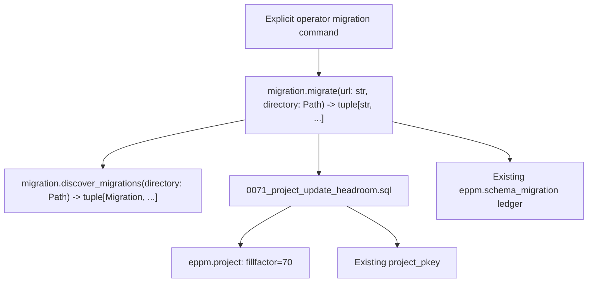

# Project update headroom

Migration 0071 reserves 30% of `eppm.project` data pages (`fillfactor=70`) for
updates. It repacks existing rows using `project_pkey` and refreshes table
statistics, so upgrades of dense populated databases receive the same headroom
as new databases. Existing records, constraints, indexes, grants, RLS policies,
authorization and transaction replay rules remain unchanged.

The ten-editor diagnostic failed on dense pages, while paired repacks with
headroom let all ten independent title saves succeed on their first attempts.
[PostgreSQL HOT updates](https://www.postgresql.org/docs/18/storage-hot.html)
can avoid new index entries when updated rows fit on the same page. Headroom
reduces avoidable index/predicate contention; it does not guarantee that every
future transaction will be free of serialization failures. Serializable writes
still replay whole authorized operations at most three times.

Apply through the existing explicit operator migration command during a
maintenance window. [CLUSTER](https://www.postgresql.org/docs/18/sql-cluster.html)
blocks reads and writes to this table while repacking and needs temporary space
for rebuilt table/index files (possibly an additional sort file). Lower page
density also increases steady table storage. Plan space for the existing table,
its rebuilt replacement and indexes. The migration is transactional and does
not change project values. It never runs from authenticated application startup.

## C4 level 4: existing migration execution

The existing migration runner owns the connection, advisory lock, transaction
and checksum ledger. The new SQL only alters page density, clusters the project
table through its existing primary key and analyzes it. No new runtime service,
configuration variable or architectural layer is introduced.

Regression tests verify ten on-page title updates using transaction-local HOT
statistics, populated upgrade/reentry preservation and rollback of a deliberate
failure after repacking. Existing concurrent editor, authorization, allocation
and three-attempt transaction tests remain the behavioral checks.

## Integration with the released dictionary migrations

Main's applied migrations 0069 and 0070 remain byte-for-byte unchanged. The
unreleased storage repair moved from its preview number 0069 to 0071, keeping
its SQL bytes identical. Upgrade regression coverage now starts at main's
70-migration schema and verifies populated upgrade, rollback and reentry.
The original preview's migration ledger is incompatible with main's different
0069 checksum; do not edit an existing ledger to hide that mismatch. No
persistent application database is reset or migrated by this reconciliation.
