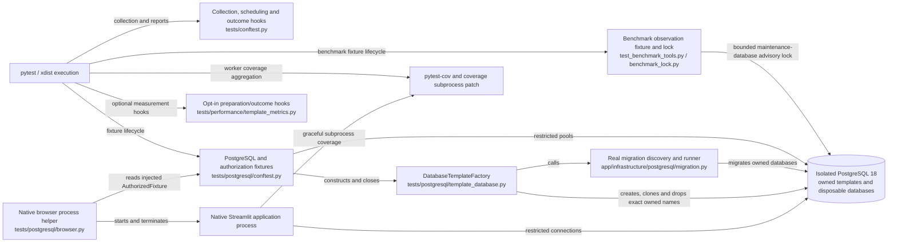
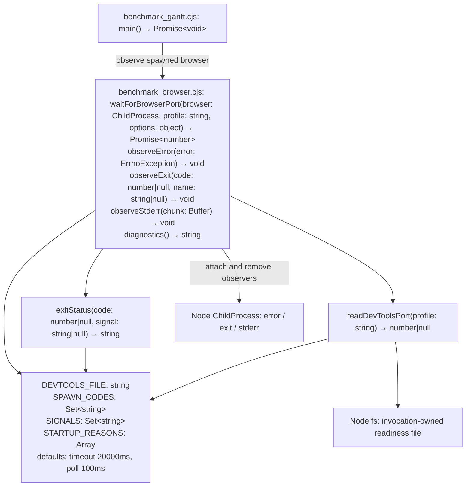

# Isolated PostgreSQL test databases

Test infrastructure uses explicit `POSTGRES_TEST_ADMIN_URL` and
`POSTGRES_TEST_RUNTIME_URL` values for the same isolated server, with different
operator and restricted runtime logins. Keep credentials in ignored local files.
Never point these settings at an application deployment.

## C3 — test infrastructure components

This component view covers the existing pytest execution environment. Each test
process is either the serial runner or an xdist worker; the controller also
receives worker collection and outcome reports. PostgreSQL is the isolated test
server, including its invocation-owned databases, rather than a new service.



## Template lifecycle

`tests/postgresql/template_database.py` provides `DatabaseTemplateFactory`.
The pytest fixtures use this owner for both preparation modes. After complete fresh/template/parallel acceptance, migrated templates are the
default. Both preparation modes remain explicitly selectable:

```bash
python -m pytest --postgres-test-db-mode=fresh
python -m pytest --postgres-test-db-mode=template
```

Supply the same isolated test credentials and other prerequisites as for normal
PostgreSQL verification. `pg_database` yields a new migrated database in either
mode. `empty_database` always yields an independent unmigrated database, including
when a test explicitly requests both fixtures. Existing imports of
`PostgreSQLFixture` and `database_url` from the PostgreSQL conftest remain valid.
Template mode does not bypass historical upgrade or rollback migrations.

Each factory owns an invocation/worker-qualified namespace and records the exact
databases it successfully creates. Its first `clone()` builds a fresh database
through the real migration runner and checks every migration version, name and
checksum, including companion Python migration code. It closes all source
connections and disables new connections before using that database as a
template. The source contains migration state only; business data, actor keys,
sessions and role assignments are seeded separately for each test.

Every clone has a separate database and lifecycle UUID. PostgreSQL copies its
schema, data and sequences; the helper explicitly restores database ACLs, grant
options, connection limits, database settings and per-role database settings.
Those database settings are not generally copied by `CREATE DATABASE TEMPLATE`.
The helper verifies configuration parity before exposing the clone.

`empty()` yields a genuinely unmigrated database. `fresh()` creates a separate
database and runs migrations normally. Neither path shares a template or business
state. No template persists across factory sessions, so source changes cannot
reuse a template left by an earlier invocation.

Close pools and child processes before leaving their database context. Close the
factory after its contexts have exited; it removes owned clones before their
template. Failures during initialization register cleanup immediately after
successful database creation. A creation/configuration failure fails the test
explicitly rather than silently changing preparation mode.

Cleanup accepts exact registered names only. It never sweeps a prefix, deletes a
volume, changes shared passwords or terminates sessions in an unowned database.
Driver failures expose an error category without connection strings or SQL
payloads. Informational lifecycle logs contain only owned identifiers.

A killed process cannot guarantee its finalizers run. Preserve the owning run's
exact identifiers when diagnosing a worker crash and inspect ownership before
manual recovery. An unknown leftover is not permission to delete every matching
database. Worker-crash and parallel-run behavior is verified separately before
parallel CI is enabled.

## Isolation and process failures

`test_template_isolation.py` seeds two simultaneous clones through the same
`authorized_database()` context used by the ordinary `authorized` fixture. Each
seed creates its own signing key, sessions and grants after cloning. Native
authorization rejects a sibling's signing key, session revocation stays local,
business changes invalidate only their own cache snapshot, and generated project
IDs and revision generations remain independent. A subsequent pristine clone
proves that business and authentication seeds never reached the source.

Concurrent factories deliberately use the same worker label: their random
invocation identities remain distinct, and closing one leaves the other's live
clone and template intact. New factories revalidate source checksums rather than
finding a previously migrated template by name. An epoch initialization fault
must fail before yielding a clone and clean up its exact registered resource.

The process regression distinguishes normal pytest `-x` teardown from a hard
process exit. Normal failure runs finalizers; hard exit leaves two owned
resources. The test records only exact database names, OIDs and owner OIDs before
the controlled crash. Its parent recovers those exact resources only when all
three coordinates still match, and verifies that a foreign test database
survives. This is a bounded test recovery procedure, not a production controller
cleanup guarantee. After an uncontrolled worker kill, retain lifecycle logs,
verify that the owning process has stopped and check the exact database identity
and owner before targeted manual cleanup. Never sweep `eppm_test_%`, recreate
shared roles or delete an unknown database to recover a run.

## Full-suite proof with workers

The development dependency is `pytest-xdist>=3.8,<4`; version 3.8.0 is exercised
on the supported Python 3.14 runtime. See its [published package metadata](https://pypi.org/project/pytest-xdist/3.8.0/).
Serial execution remains available, and CI remains serial until measured
acceptance. Worker scheduling safety is a separate prerequisite to enabling
parallel execution of the application suite.

With `--require-full-suite`, the controller compares every worker's complete
ordered collection, requires PostgreSQL and authenticated-browser groups, and
reconciles exactly one call and final teardown per selected test. Setup skips
or errors do not require a call report, but required skips still fail. Subtests
retain their parent collection identity. Workers forward required collection
skips as well as runtime skips; a normal exit without that proof fails. Missing
or duplicate outcomes, divergent collections and worker loss cannot become a
passing partial run. Strict mode disables worker replacements, including when a
caller requests a restart allowance. Existing nonzero pytest statuses remain
nonzero, and ordinary serial prerequisite/skip behavior remains unchanged.

## Audited scheduling and shared resources

Parallel application verification supports exactly `-n 2 --dist=loadgroup`.
Use `-n 0` for serial diagnostics; `auto`, larger worker counts and other
schedulers are rejected before worker startup. Modules whose names contain
`browser` or `benchmark`, deployed recovery, the five native browser callers
without browser filenames, and subprocess verification harnesses share
`browser-benchmark-deployment`. The policy lives in `tests/conftest.py`.
The controller rejects conflicting combined group marks before dispatch.

The source audit checks all direct native browser/benchmark creators. Collection
regressions compare the complete repository manifest with both actual worker
collections; a separate execution probe proves heavy members share a worker and
every selected ID executes once. Grouping serializes its own members only: the
other worker continues ordinary database/unit work. It is not an exclusive
barrier and does not coordinate a second pytest invocation.

`test_benchmark_tools.py` contains both cluster-wide `eppm_benchmark_%` observers
and every direct/indirect test creator, including operator CLI calls. Its
autouse fixture takes a session advisory lock on the explicit test server's
maintenance database, with a bounded 180-second acquisition timeout, before
observing or creating benchmark copies. This also serializes cooperating test
invocations. A contended-lock regression verifies bounded failure and release;
independent real worker processes verify non-overlapping lock intervals.

The audit found no shared-role password/grant mutation in workers. The foundation
security test creates UUID-qualified roles and removes only those roles. Template
role settings are database-specific; ordinary grant/revoke tests change ACLs in
their own database. Backend termination targets a PID selected from the same
owned pool. Cache/process environment changes are process-local and restored.
Native servers use candidate loopback ports and per-test directories; ports are
released before startup, so they are not persistent reservations. Deployed OIDC
and recovery use distinct UUID-qualified Compose projects/volumes and ports.

Browser screenshot paths are diagnostic outputs, not inputs or shared state
assertions; one heavy worker writes them within a run. Use separate checkouts
for simultaneous complete runs so fixed `.local` diagnostic paths and coverage
outputs do not overwrite each other. Do not run unrelated manual benchmark
commands against the isolated verification server while its test observers run.

The initial budget is two application workers on the 8-CPU Docker host with
about 7.48 GiB allocated memory and PostgreSQL `max_connections=100`. Most pools
use at most two connections; native component children allow four. The largest
deliberate concurrency regression has one ten-connection pool plus its normal
fixture pool; the sixteen-thread composition case constructs a closed pool.
Reserve a conservative 40 test-client connection budget, including setup,
nested verification probes and monitoring; record actual peaks during focused
and full runs. Full two-worker memory/disk/connection evidence remains required
before CI promotion, and a repeat failure or resource conflict blocks promotion.

## Combined coverage

Keep the existing `--cov=app --cov-fail-under=95` full-suite command, coverage
source/exclusions, `patch = ["subprocess"]` and `sigterm = true`. Pytest-cov
combines the worker measurements; native Streamlit children save their data on
graceful termination. Apply the 95% threshold to the aggregate report. A worker's
individual percentage is not an additional gate or the whole-suite result.

`test_parallel_coverage.py` verifies exclusive existing application branches in
two distinct worker processes and one native Streamlit child. It checks the
combined report contains all three branches under one source path, with fresh
per-test coverage files. The same proof also runs serially and under outer
coverage instrumentation. Missing reports, a worker crash and a deliberately
incomplete measurement with the unchanged 95% gate all remain nonzero.

These focused branch probes do not assert whole-application acceptance. Full
runs must still meet 95% across `app` with no required skips. Real containerized
OIDC/recovery remains a separate behavior gate; container application execution
is not attributed to the host's native-subprocess coverage.

## Accepted full-run configuration

Full PR CI uses exactly two workers with loadgroup scheduling and no worker
restarts, preserving every test and the strict completion/95% coverage gates:

```bash
python -m pytest -q -x -p no:cacheprovider --require-full-suite \
  --cov=app --cov-fail-under=95 -n 2 --dist=loadgroup \
  --postgres-test-db-mode=template --max-worker-restart=0
node --test tests/test_*.cjs
```

Use the isolated credentials, real OIDC option and browser/client prerequisites
in [the development workflow](development-workflow.md). For a serial diagnostic
reference, select `-n 0 --postgres-test-db-mode=fresh`; this retains all historical
migrations. During editing, run affected test paths locally for quick feedback;
partial runs do not satisfy the full PR or OpenSpec acceptance gates. The
measurement plugin is opt-in and is not enabled by normal PR CI.

The controlled local full runs passed 3,304 cases plus five subtests and 112
JavaScript cases at 97.68% coverage. The slower of two complete parallel runs
took 21m17s versus 42m18s fresh/serial, a 49.7% reduction; median preparation
improved 67.7%. These pytest timings exclude provisioning/build/install time.

## Native Gantt browser startup

The Gantt diagnostic keeps Chromium's sandbox flags and its 20-second readiness
limit. `scripts/benchmark_browser.cjs` observes the one spawned browser; it does
not retry or replace it. Spawn errors and early exits fail immediately with
allowlisted OS metadata. Startup stderr contributes only fixed classifications
(sandbox, resource limit, disk space, profile lock, crashpad or DevTools announced).
A bounded 4 KiB rolling buffer handles split messages; raw child output is never
included in the failure. After startup, stderr is drained without retention.
A live browser that never produces a complete `DevToolsActivePort` handshake
still fails at the existing deadline. Partial writes do not release readiness.
The driver retains responsibility for browser/session cleanup and source-copy
isolation. A classified signal is diagnostic evidence, not proof of a universal
underlying Chrome cause.

C4 code view of this diagnostic boundary (Node built-ins are actual dependencies):



`node --test tests/test_benchmark_browser.cjs` covers complete/partial handshakes,
spawn failures, early exits/signals, live deadlines, stale files and a real child
exit, including raw-output privacy. The existing PostgreSQL benchmark test keeps
its original rendering, source-preservation and cleanup assertions. Full PR CI
continues to execute every test with strict completion and 95% coverage.
