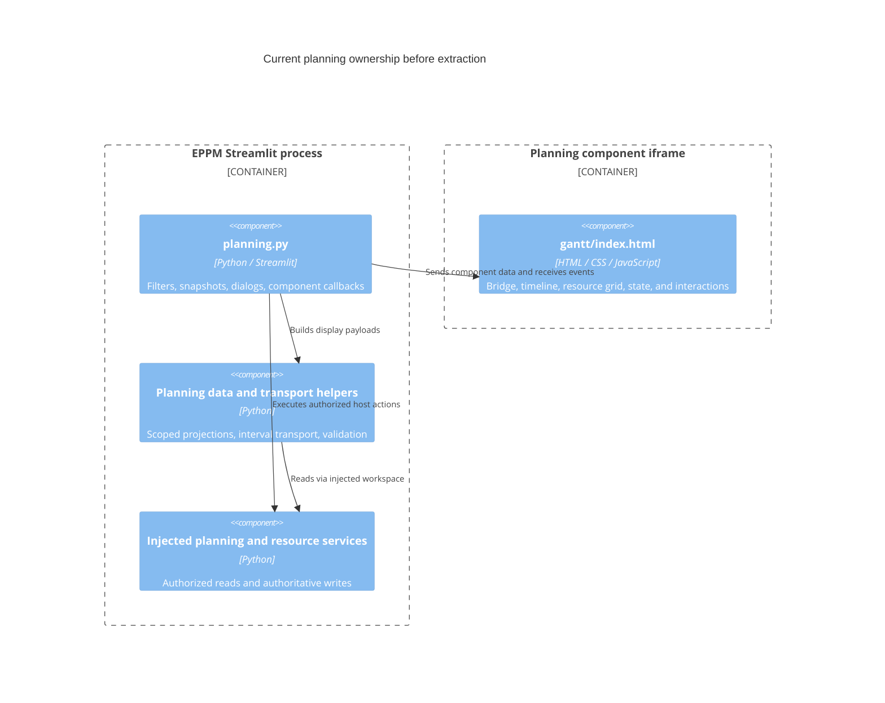

# Design

## Context

See `proposal.md` for motivation and scope. Inspection on refreshed main (`0b6ebb0`) found:

| Existing owner | Observed responsibility |
| --- | --- |
| `app/presentation/assets/components/gantt/index.html` | 7,511 lines; 165 top-level function declarations, 108 top-level bindings, inline handlers, document-wide selectors, and shared mutable state |
| Browser bridge and render handler, lines 2289 and 7273 | Streamlit messages, permissions, snapshots, patches, and scenario payloads |
| `requestPlanningTasks`, `scheduleProjectLoads`, `applyPlanningPatch` | Same-origin HTTP hydration, 25-project batches, 100-project retention, cancellation, revisions, eviction, and targeted updates |
| `computeTimelineBounds`, `buildHeaderStructure`, `renderTimeline`, `renderVirtualWindow` | Calendar geometry, grouping, sorting, row positions, virtual rendering, bars, and edit interactions |
| `renderDependencyLinks`, `renderAlternativeLinks` | Dependency indexing, clipped/bundled paths, endpoint resolution, and scenario rendering |
| Resource helpers starting at line 4910 | Daily series and period caches, minimum capacity, daily excess, hierarchy display, and resource virtualization |
| `app/presentation/pages/planning.py` | `_interactive_gantt`, session snapshots, host event routing, filters, and application dialogs |
| `planning_data.py`, `planning_events.py`, `planning_transport.py` | Presentation projections, boundary validation, revision tokens, and lossless interval transport |
| `app/presentation/components/plan_gantt.py` | A separate smaller Project plans comparison display, outside the extraction scope |

The browser code declares `setViewMode` twice (lines 3139 and 5850). Setup runs immediately and again on `DOMContentLoaded` (lines 7497-7502); a focused harness reproduced two registrations of splitter mousedown and window mousemove/mouseup handlers. Extraction must remove these duplicates with observable regression tests.

The Python integration is already presentation-owned and receives `PlanningWorkspace`; application/domain services remain the business owners. ADR 0009 requires protocol and behavior preservation. ADR 0029 and current code govern relational current/baseline/alternative semantics; earlier superseded ADR 0028 storage descriptions are not migration instructions. ADR 0059 distinguishes minimum capacity, peak demand, and maximum daily excess. Existing bounded-cache, bounded-dependency, and shared-filter specifications remain unchanged.

Current Gantt JavaScript tests read the HTML, slice functions by source markers, and execute the fragments in VM contexts. Browser tests and `scripts/benchmark_gantt.cjs` also depend on selectors or globals. These are consumers to migrate deliberately, not reasons to retain globals in the public interface. Root package data includes component HTML only, so extracted nested modules/styles need explicit distribution coverage.

### C3: current implemented ownership

## Goals / Non-Goals

**Goals:**

- A deep module with one small host interface and private internal seams for geometry, state, rendering, and interactions.
- Reuse of the same browser implementation from EPPM, an ordinary web host, and an independent Streamlit installation.
- Explicit ownership of async reads, update invalidation, and resource disposal without changing current server semantics.
- An extraction whose UI, data semantics, package completeness, and responsiveness can be compared with the current implementation.

**Non-Goals:**

- New persistence, scheduling, approval, authorization, or resource-allocation rules.
- A React/Vue migration, general plugin framework, automatic scheduling engine, or externally hosted asset dependency.
- Consolidating the separate Project plans Gantt, public registry publication, or a separate source repository in this change.

## Decisions

### 1. Extract native JavaScript modules behind instance ownership

Use native ES modules and scoped CSS, with no new browser runtime dependency. A mount factory owns the state, private renderers, and cleanup registry. Pure functions handle date geometry, period summaries, row projection, and dependency layout. Renderers receive their required model and collaborators explicitly.

Proposed source homes (these do not exist yet):

| Proposed home | Responsibility |
| --- | --- |
| `packages/planning-view/src/contracts/` | Documented JSDoc types, version checks, runtime validation, normalized snapshots/patches/events |
| `packages/planning-view/src/calendar/` | Date-only arithmetic, scale/header cells, x coordinates, inclusive endpoints |
| `packages/planning-view/src/state/` | Instance view state, indexed data, patch application, loading working set and invalidation |
| `packages/planning-view/src/timeline/` | Task/project rows, bars, dependency layout/rendering, baseline/alternative overlays, drag/resize |
| `packages/planning-view/src/resources/` | Period summaries, hierarchy rows, resource viewport, cells and interactions |
| `packages/planning-view/src/workspace/` | Scoped shell, viewport coordination, splitters, headers, menus/editors/tooltips and lifecycle |
| `packages/planning-view/src/adapters/streamlit.js` | Exported Streamlit browser bridge, event delivery, and frame-height reporting |
| `packages/streamlit-planning-view/` | Independent Python wrapper, packaged browser assets, tests, installation examples |
| Existing EPPM Gantt directory and presentation helpers | Thin EPPM bootstrap, payload/event translation, authenticated HTTP loader and application actions |

These are cohesive ownership groups rather than one file per old function. Do not expose renderers, mutable maps, or each internal helper as a consumer interface. Moving functions while retaining shared globals would not satisfy the extraction.

Alternative: a React rewrite or adoption of a third-party Gantt would expand dependencies and risk feature drift. A cosmetic file split would leave the coupling intact. Native modules fit the current implementation and can be consumed without a framework.

### 2. Define one versioned mount/update/dispose contract

The proposed exported factory is `mountPlanningView(root, options)`, returning an instance with `update(message)` and `destroy()`. This is an interface sketch, not implementation. Document its invariants and failures alongside types; callers never manipulate private maps or DOM.

- `options` supplies a version-1 initial snapshot, presentation options, an event sink, and optional loader. The default resource view can be disabled and fully supplied data needs no loader.
- Normalized records cover projects, tasks, dependencies, resource series/hierarchies, and optional overlays. Identifiers are opaque strings; task identity is unique within an instance, and the EPPM adapter maps existing numeric/stable identities without collisions. Comparison records explicitly distinguish current row identity from stable pairing identity.
- Calendar values are valid ISO date-only strings. Validate real dates and ranges before applying them. Use calendar-day arithmetic internally rather than elapsed local milliseconds across daylight-saving changes.
- Update messages distinguish complete snapshots, atomic patches, and correlated action/load responses. Include view scope, data revision, request identity, and explicit reset intent where relevant. Validate the complete message before changing state; build indexes and invalidate only affected projections/caches.
- Capabilities describe allowed UI operations; they never confer server permission. Labels and generic context-action descriptors have stable command identifiers and text, never arbitrary executable HTML. The resource unit label is presentation configuration, with FTE retained for EPPM.
- Events distinguish task/date/progress/dependency edit requests, selection, extension commands, and safe load/error notifications. Request identities remain stable across a host rerun; an accepted patch or rejection reconciles the preview. The host remains authoritative.
- Scope switches reset documented state; same-scope patches preserve unaffected editor drafts and viewport. Entity deletion invalidates its open draft explicitly. Capability revocation disables stale actions immediately.

Use JSDoc plus runtime validation initially; a TypeScript toolchain is not required to document or enforce the contract. Unsupported versions fail explicitly. Public methods remain small even though internal tests may exercise private seams.

### 3. Give shared geometry one owner and keep rendering local

One calendar model produces header cells, positions, widths, and visible ranges used by both timeline and resource renderers. A workspace coordinator owns horizontal scroll and frozen-pane sizing; each renderer retains its own vertical window. Scroll writes are guarded against feedback loops and scheduled once per frame.

Use root-relative DOM queries and scoped `.planning-view` styles/custom properties; remove page-wide resets and inline event-handler attributes from reusable markup. Generate unique SVG marker/clip identifiers per instance. Register delegated handlers once and clean them through an instance-owned registry/abort signal. Cleanup also cancels tooltips, selection delays, animation frames, observers, active drag listeners, and reads. Destroying twice is safe.

Keep timeline row virtualization, resource row/column virtualization, dependency indexes/clipping/bundling, and cache invalidation. Generic scheduling dialogs and dependency diagnostics remain available through the display; EPPM-owned dialogs and commands are provided by its integration. Shared primitive render helpers can reduce repetition between current and alternative bars/links without collapsing their distinct editing semantics.

Alternative: separate Gantt/resource iframes would complicate date alignment, scrolling, and sizing. Independent internal renderers under one mount retain coordination without global coupling.

### 4. Preserve data semantics and loading behavior

Separate interval decoding and capacity summarization from DOM rendering. Preserve zeroes, missing-day gaps, inclusive intervals, total/selected/comparison demand, minimum effective capacity, maximum demand, and maximum positive daily excess. Validate parity against Python-derived fixtures without moving authoritative business calculations into JavaScript.

The loading controller calls an injected asynchronous provider with project identifiers, scope/revision, request identity, and cancellation signal. It owns visible-before-overscan priority, coalescing, one active batch, bounded retention, eviction, and rejection of old generations. EPPM keeps its existing limits of 25 requested and 100 retained projects. Other hosts can configure finite limits. Fully supplied schedules bypass hydration.

An EPPM browser adapter implements the current same-origin `/api/planning/tasks` requests and source-token mapping. Credentials, endpoint selection, 403/409 authorized refresh, and response normalization belong there. Preserve the current event fallback for hosts without the direct HTTP provider. Ordinary failures retain rows and allow an explicit retry; no retry loop is introduced.

Keep immutable snapshots or replacement-based series updates so memoized period indexes cannot silently use mutated values. Flatten resource hierarchies iteratively with visited-identity/cycle checks; avoid unbounded recursive traversal. Summaries do not include hidden history or fetch undisclosed dependency endpoint details.

### 5. Keep Streamlit and EPPM responsibilities distinct

The exported Streamlit JavaScript adapter translates bridge messages, forwards generic events, reports height, and disposes its mounted instance when appropriate. The independent Python wrapper requires the supported Streamlit runtime and Python 3.14; it has explicit widget keys, typed parameters, safe event validation, useful docstrings, and no `app.*`, database, pandas, or EPPM-service imports.

The generic wrapper supports a supplied snapshot and correlated component-event/load-response updates. It does not serialize Python callbacks as JavaScript. An independent Streamlit host can respond to a load event in Python and supply a response on rerun; the bridge queues/coalesces reads so its single component-value channel does not drop user actions. The plain-browser host supplies a direct loader callback.

EPPM retains `_interactive_gantt` as its Python presentation facade and preserves its current action names and server event validation. Its thin browser bootstrap imports the shared core and Streamlit adapter and supplies the EPPM normalizers, extension commands, and direct HTTP provider. It maps the new display events into existing Python callbacks. It must not move scenario lifecycle or server authorization into the reusable packages.

This preserves ADR 0009's application protocol and widgets through an adapter while changing their implementation. Current relational behavior, current/baseline/alternative permissions, CSV workflows, tags/pools, project/dependency editors, and navigation continue through existing services. Update implementation documentation and add an ADR explaining this ownership; existing accepted business decisions are unchanged.

### 6. Produce portable artifacts from one browser source

Keep source and release assembly in this repository. Build a browser package archive containing ES modules, CSS, and contract/package version metadata. Build a separate Python wheel and source distribution with the generic Streamlit frontend and those exact modules/styles. Names are provisional local package names until a separate publication decision.

Use deterministic asset assembly from `packages/planning-view` for the generic wrapper and EPPM bootstrap asset directories; generated copies are build products, not separately maintained implementations. Include a source/version/content manifest and fail builds/tests on missing or stale assets. An extracted Python source distribution contains the prepared browser tree so rebuilding its wheel needs no EPPM checkout or JavaScript compiler. No frontend build runs at application startup.

Root EPPM packaging, Docker builds, and CI invoke asset preparation explicitly and include nested JS/CSS/HTML resources. EPPM consumes the shared browser implementation and bridge; independent Streamlit consumers install the standalone wrapper. No unpublished registry package becomes an implicit root dependency. Keep the current Python runtime bounds and document the actual browser/Node tooling used by checks.

Add an ordinary web example served over HTTP and an independent Streamlit example. Artifact smoke tests install/unpack distributions outside the checkout, remove source paths from import/search resolution, and verify rendering plus event delivery. Test the wheel built from the source distribution as well as the directly built wheel. Public registry publication and a separate repository remain follow-up decisions.

### 7. Replace fragile test surfaces without losing behavior checks

Before extraction, add externally observable characterization where needed and record reference benchmark results on this branch. Retain the existing assertion meanings for scrolling/alignment, resource scopes, edit permissions, baselines/alternatives, keyboard menus, delayed tooltips, and filters. Move source-slicing assertions to imported pure modules, mount/update interfaces, or real browser behavior. Keep selector checks only where DOM/accessibility structure itself is the contract.

Add two-instance tests, repeated mount/dispose tests, in-flight cancellation/stale responses, malformed input, opaque IDs, scoped styling, event deduplication, host rejection, reset behavior, and clean artifact installations. Exercise supported EPPM workflows against isolated PostgreSQL and authenticated browsers; mock only external boundaries.

Adapt `scripts/benchmark_gantt.cjs` to mounted-instance interactions and measured DOM behavior rather than private globals. Preserve its resource row bound (at most 40 in the representative viewport) and pane alignment tolerance (at most 1 px). Retain batch/retention and viewport-sized timeline/dependency work checks. Record initial-render time, scroll-work/frame p95, DOM counts, payload size, and host edit timings in identical fixtures/configurations before and after extraction.

For timing comparisons, use five paired runs in the same environment. On 2026-10-18 the user explicitly approved revised initial-render median limits of 150 ms for each synthetic configuration and 60 ms for the native PostgreSQL configuration, after reviewing the measured regression. These limits apply only to initial rendering. For all other applicable timing metrics, a median regression exceeding both 10% and 5 ms still blocks acceptance until resolved or explicitly agreed. Keep all existing hard benchmark assertions, including resource rows at most 40 and pane alignment at most 1 px, unchanged. This extraction budget is not an application-wide performance promise.

Final acceptance requires the repository's strict full pytest suite with isolated PostgreSQL and authenticated browser execution, at least 95% application coverage, all existing JavaScript checks, new package/module/browser checks, and strict OpenSpec validation. Report standalone-wrapper coverage separately at a minimum of 95%; aim for full coverage of contract parsers and calendar/capacity rules. Existing `app` coverage is not reduced or replaced by package-only results.

## Risks / Trade-offs

- State ownership changes can reset drafts or viewport position -> explicit same-scope/new-scope update rules and browser tests before switching EPPM.
- Date normalization can shift bars at DST boundaries -> date-only arithmetic and UTC/Europe-Luxembourg parity fixtures before extraction.
- Capacity cache and rounding drift can change warnings -> shared Python-derived fixtures for zero, gaps, extrema, display precision, and comparison demand.
- Source-slicing tests and benchmark globals can conceal coupling -> replace each with behavior checks and preserve their assertion coverage in a traceability table.
- A standalone Python package can accidentally depend on the checkout -> wheel/sdist installation and browser tests outside the source tree.
- Generated asset copies can drift -> deterministic assembly, version/content manifests, and installed-artifact parity checks.
- Additional interfaces can become a generic framework -> keep one public mount/update/destroy surface and only the loader, event sink, labels/options, and context commands needed by the three concrete hosts.
- Concurrent unrelated development can alter the baseline -> keep this branch isolated, rebase/merge only by an authorized workflow, and rerun relevant checks after integrating approved upstream changes.

## Migration Plan

1. Commit this validated plan on `codex/reusable-planning-component`. Await a separate apply request.
2. Characterize current behavior and benchmark fixtures, then implement pure contracts/calendar/resource models and instance state without replacing the running EPPM display.
3. Add instance renderers and the standalone host/Streamlit bridge. Prove core behavior and lifecycle in fixture hosts.
4. Switch EPPM through its compatibility facade, preserving current Python/API semantics. Remove duplicated initialization and the old monolithic implementation once parity tests cover its behavior; keep the existing component directory as a thin bootstrap if needed.
5. Complete distribution assembly, standalone consumer examples, install tests, documentation/ADR, benchmarks, and full acceptance evidence.
6. After successful implementation verification, follow archive/PR delivery and explicit merge approval. Do not publish packages to registries as part of this change.

Deployment uses the existing application image/build pipeline with assembled local assets. No data migration, feature flag, or server cutover is needed. If regressions appear, revert the integration commit and rebuild the previous application revision; current business data remains compatible. Do not keep two active renderers or long-lived fallback implementations after acceptance.
