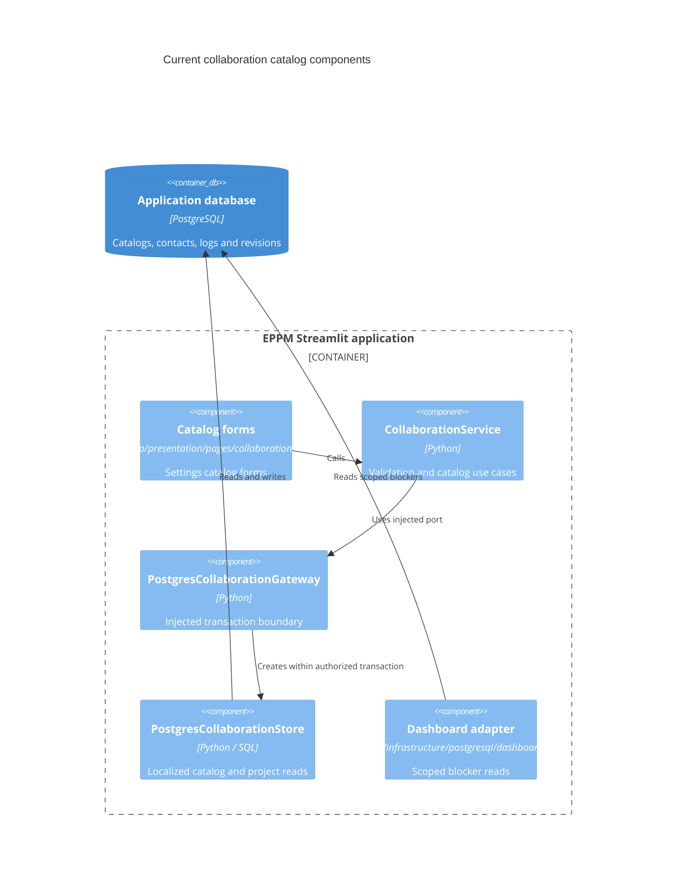

# Design

## Authorized browser acceptance repairs

The user authorized diagnosis and repair of intermittent access-administration
project selection and dashboard project deselection after the initial full-suite
attempts. Task 5.2 covers reproduction, interaction/rerun corrections and regression
tests. Preserve authorization, fragment boundaries and all existing behavioral
assertions. These repairs do not change the shared dictionary data model or scope.

Dashboard click events carry unique nonces and a token for the current revision
and active filters, independently of the selected-row paging snapshot. The server
still reauthorizes every click against current filtered projects. Paging retains
its own selection-dependent token and bounded cache.

Named-project access scopes use the existing bounded administrator search and a
scrollable native checkbox list. This removes the pinned framework multiselect's
transient empty typeahead events from this workflow. Multiple selection, explicit
Grant access submission, server-side validation and permission checks remain.

## Context

See [proposal.md](proposal.md) for motivation and confirmed scope. The planning
baseline is fetched `origin/main` at `0b6ebb0`, in the isolated
`codex/shared-business-dictionary` worktree. The unrelated, uncommitted
`test-performance-templates` work remains in its original checkout.

Observed implementation and contracts:

- Migration 0002 defines two independent catalog IDs, canonical names and
  translations; IDs can overlap. Contacts reference roles and logs reference
  event types using `ON DELETE RESTRICT` foreign keys.
- `PostgresCollaborationStore` resolves requested translation then canonical
  name. A catalog save writes the name and English label in one transaction.
  `CollaborationService` accepts `role` / `event_type` and returns `id`, `name`,
  `label` projections. Real PostgreSQL tests cover these contracts, rollback,
  scoped contact data and complete transaction retry.
- Migration 0003 classifies an inserted type named exactly `Blocking Point` when
  no blocking-point classification exists. `system_code`, not the translated
  label, drives dashboard blocker queries; rename preservation has a regression.
- Migration 0006 installs shared-read policies, shared-write guards and audit
  infrastructure. Migration 0016 attaches catalog revision triggers to all four
  current catalog tables. Shared catalogs do not currently have an unconditional
  per-label security-audit event; retain actual audit semantics rather than
  claiming such a feature already exists.
- `seed_catalog.py` and `reset.py` contain direct catalog SQL. Reference markers
  prevent ordinary reinitialization from restoring removed choices. Full reset
  clears roles/event types and restores the established event seed.
- Project Configuration already has lazy role/event/WBS tabs. Its catalog form
  edits a canonical name but has no general translation editor. The application
  has five presentation locales: en, fr, de, lb and pt.
- ADR 0010 owns collaboration transaction/reference guarantees; ADR 0012 owns
  packaged interface translation resources. This change extends ADR 0010's
  storage implementation while retaining those guarantees. ADR 0063 is unaffected.

### Current C4 level 3 boundary

This diagram describes existing components only. Proposed additions are described
in the decisions below and are not represented as already implemented components.

## Goals / Non-Goals

**Goals:**

- Make entry and translation storage reusable without losing dictionary type
  safety, numeric IDs, or current project ownership boundaries.
- Keep shared catalog mutations on one existing authorized transaction and retry
  path, including canonical-name/English-label synchronization.
- Deliver practical translation maintenance through the existing Settings tabs.

**Non-Goals:**

- A generic business-object store, arbitrary dictionary creation, a new process
  or public API, or a change to workflow and security-scope modeling.
- New lifecycle states for reference data. Deletion remains restricted when used;
  this increment does not introduce `is_active` or soft-deletion behavior.
- Rolling compatibility with old application binaries or externally supported SQL
  table names. Migration and application rollout are coordinated.

## Decisions

### 1. Use three normalized shared tables with composite entry identity

The proposed relational structure is:

| Table | Key and data | Integrity |
| --- | --- | --- |
| `business_dictionary` | `code text` primary key | Seed only `project_role` and `project_event_type`; runtime definitions are read-only |
| `business_dictionary_entry` | `dictionary_code text`, `id bigint`, `code text`, `name text`, nullable `system_code text` | Restrictive FK to dictionary code; primary key `(dictionary_code,id)`; unique `(dictionary_code,code)`; unique `(dictionary_code,system_code)`; unique `(dictionary_code,lower(name))` |
| `business_dictionary_translation` | `dictionary_code text`, `entry_id bigint`, `locale text`, `label text` | Primary key `(dictionary_code,entry_id,locale)`; composite entry FK with `ON DELETE CASCADE`; nonblank locale/label |

Migration 0070 completes the locale integrity check without rewriting 0069. Its
initially unvalidated check preserves any historical blank keys while enforcing
the rule for new writes. It validates existing rows immediately when compatible.

Entry IDs retain their original numeric values in each dictionary. A single
identity sequence supplies new IDs and advances beyond the maximum migrated ID
across both catalogs; IDs are not globally unique and must never be used alone.
For legacy entries, assign deterministic opaque codes `entry_<id>` within their
dictionary, independent of names and language. New entries use the same scheme
after allocating their ID. A BEFORE INSERT rule can populate omitted codes from
the already allocated ID. Runtime inserts select an allowlisted dictionary but
cannot supply IDs, stable codes or system classifications. Runtime updates cannot
change identity, dictionary membership, codes or classifications; names can change.
Database identity guards and column grants enforce those restrictions, while the
operator migration can insert the preserved legacy IDs and classifications.

Keep `system_code` separate from the opaque entry code. It is optional semantic
metadata: this release allows it only on `project_event_type` entries. Preserve
all existing event-type system-code values and their uniqueness. Shared storage
does not interpret arbitrary labels as business behavior.

**Alternatives:** a globally unique entry ID would require remapping overlapping
legacy references; label-derived codes would make rename compatibility fragile.
Keeping four authoritative catalog tables behind a common editor would not
deliver the requested shared storage. JSON translation columns would weaken
per-locale keys and violate the established translation-table convention.

### 2. Enforce consumer membership with composite foreign keys

Retain `project_contact.role_id` and `project_log_event.event_type_id`. Add a fixed,
database-controlled discriminator to each consumer: generated stored
`role_dictionary_code = 'project_role'` and
`event_type_dictionary_code = 'project_event_type'`. Replace the old FKs with
`(discriminator,numeric_id)` references to the shared entry key, retaining
`ON DELETE RESTRICT`. Add matching referencing indexes.

Generated discriminators cannot be supplied as another dictionary through direct
SQL. They stay out of public DTOs; existing explicit-column writes and projections
retain the same integer contract. Update test fixtures that intentionally inspect
physical storage rather than changing their behavioral assertions.

**Alternatives:** a bare entry-ID FK cannot prove dictionary membership. Validating
only in Python permits invalid direct/concurrent database writes. Thin per-kind
tables preserve old FK shapes but leave an extra catalog synchronization layer.

### 3. Share typed validation and SQL without nesting transactions

Add proposed domain records/validators in `app/domain/dictionaries.py`, a typed
port in `app/application/ports/dictionaries.py`, a dictionary application service,
and a PostgreSQL store/gateway under the existing layers. Dictionary code inputs
are a two-value allowlist. IDs, names, translation mappings and locale codes are
validated before writes; no unvalidated input becomes an SQL identifier.

Keep `CollaborationService` catalog signatures, `CatalogKind` values and
`CatalogEntry` shape. Its existing store methods delegate to the common dictionary
store using the current connection. A translation-capable dictionary service is
injected into Settings through `app/main.py` and `SettingsWorkspace`; both paths
use the same storage operations and validation. Do not construct a new pool,
gateway or transaction from inside a running collaboration transaction.

Use `run_business`, existing signed actor context, whole-operation retries and
safe errors. A single entry-edit command saves the canonical name/English label
and any submitted optional translations together. Missing-record updates fail
instead of becoming upserts. Concurrent serialization failures replay the whole
authorized operation. Keep current logging/correlation infrastructure and safe
failure categories without logging labels, payloads, credentials or raw SQL errors.

**Alternative:** separate generic CRUD routes or a second persistence framework
would add boundaries without a need in this Streamlit application.

### 4. Preserve localization behavior and add explicit translation editing

Read one dictionary and requested locale with a single join, returning
`COALESCE(translated_label,canonical_name)` and the existing lowercased C-collation
label ordering with numeric ID tie-break. Do not use UI language as a stored code
or silently fall back to another noncanonical translation.

Canonical-name editing remains the English editing path and updates the English
translation atomically. Non-English blank edits remove the explicit row. Absent
translations are distinct from rendered fallback text in the editor. Only
submitted locales change; preserve other locales and any legacy locale spelling
or values during migration. Normalize and validate new locale identifiers with a
bounded language-tag validator; reject malformed paths and blank labels except
the deliberate optional-translation removal command. Do not retroactively
normalize or merge legacy locale keys.

Offer optional fr/de/lb/pt fields through a common form in the current role and
event-type tabs; show en through the canonical-name field. Keep lazy tab loading,
current selection and established widget-key prefixes where compatible. Retain
deletion confirmation, safe error display and server-side authorization. New
interface text goes in the five packaged presentation catalogs, following ADR
0012; business label rows remain in PostgreSQL.

**Alternative:** an English-first fallback beyond the canonical name or a new
top-level Settings navigation would change established behavior unnecessarily.

### 5. Retain blocking classification and catalog revision semantics

Move the current insertion classifier to the shared entry table, guarded by
`dictionary_code = 'project_event_type'`. It recognizes the exact canonical name
`Blocking Point` only at insertion when no existing blocking-point marker exists.
Renames/translations do not recompute `system_code`. Scope system-code uniqueness
to the dictionary. Serialize competing classifications using the existing
serializable transaction/retry policy and, where needed, one dictionary-scoped
transaction lock so a concurrent insert cannot publish two classifications.

Rewrite collaboration contact/event label joins and both dashboard blocker/issue
queries to qualify the dictionary. Preserve project authorization before contact
phone aggregation, active-event filtering and existing projection fields.

Install shared-read RLS, `business.manage` write enforcement and appropriate
column/sequence grants on new storage. Dictionary definitions have no runtime
mutation grants. Retain existing protected-property audit behavior. Attach the
existing shared catalog revision invalidation mechanism to entries and
translations; avoid a second revision service or direct invalidation on rollback.
Any new or replaced privileged helper uses `pg_catalog, eppm, pg_temp`, retains
restricted execution privileges and does not permit caller-controlled SQL names.

**Alternative:** moving the classifier to translated text would make dashboard
results dependent on locale; Python-only write guards would weaken direct-SQL
security and integrity guarantees.

## Risks / Trade-offs

- Overlapping IDs could select the wrong catalog -> composite keys/FKs and tests
  with overlapping IDs, IDs present in only one dictionary and forged membership.
- Raw SQL users of retired tables could be missed -> update the enumerated
  collaboration/dashboard/seed/reset paths, search active code and fixtures,
  and complete the full database/browser suite before release.
- Legacy translation values may not fit new validation -> copy rows exactly;
  apply stricter normalization to new commands without invalidating old keys.
- Generic storage carries event-specific metadata -> constrain the nullable
  system marker to event types, keep its business meaning in collaboration and
  reporting, and require a separate decision before expanding catalog scope.
- A shared sequence changes future ID spacing -> integer references remain
  opaque, IDs are never reused, and creation tests assert integrity rather than
  consecutive per-kind numbering.
- Deploying an intermediate task commit could break old SQL -> task commits are
  review units; release only the complete verified change with coordinated
  application/migration deployment.
- Shared revision invalidation remains coarse -> retain current behavior; do not
  add speculative per-dictionary cache infrastructure in this increment.

## Migration Plan

1. Allocate the next ordered migration at implementation time (0069 if the fetched
   baseline is unchanged). Never modify migrations 0001-0068 or checksummed hooks.
   Add the new storage, indexes, definitions and security configuration through
   the existing operator migration transaction and advisory migration lock.
2. Copy both catalogs with their original IDs, canonical names, nullable system
   codes and every translation. Generate stable entry codes independently of
   labels. Assert row/value equality before replacing references; handle empty
   catalogs and sparse IDs. Advance the new sequence beyond all migrated IDs.
3. Add fixed consumer discriminators and composite FKs; validate them before
   removing old FKs. Adapt the event classifier and install shared revision
   triggers. Remove obsolete triggers and the four old tables only after their
   dependencies are handled. Avoid broad `CASCADE` object deletion.
4. Update all active SQL readers/writers and fixtures to the shared model;
   reference/demo installation creates entries and labels centrally with the
   existing markers. Full reset deletes entries only for the two registered
   dictionaries and reseeds event types; ordinary project flush retains both.
   Preserve operator backup, restore, validation and transaction boundaries.
5. Test clean initialization, upgrade from a populated preceding schema, migration
   rerun, sequence allocation, failure rollback, native FK enforcement, RLS,
   classifier/revision behavior and operator lifecycle commands in disposable
   PostgreSQL. Keep all original behavioral regressions while replacing their
   obsolete physical table assumptions.
6. Complete the dictionary service and Settings changes, update architecture and
   operational documentation, and perform full acceptance per
   `docs/development-workflow.md`. This planning turn runs OpenSpec validation
   only; implementation and database/browser acceptance happen after apply.
7. For rollout, stop application writers, use the existing operator backup and
   verify it, apply migrations, then start the matching new application image.
   A failed migration rolls back atomically. After a successful migration, repair
   forward; reverting to the old binary requires stopping writers and restoring
   the verified pre-upgrade backup, with an explicit decision about post-upgrade
   data loss. Do not run a destructive automatic down migration.

No material design question remains open. Operational values such as the final
migration number and disposable test deployment names are resolved at apply time.
