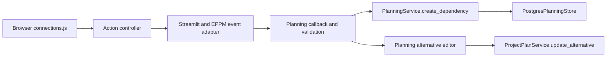

# Verification: gantt-drag-linking

## Current assessment

Implementation and final local acceptance are complete. The canonical strict
full suite passed with 3,577 tests and five subtests in 1,143.64 seconds, no test
skips, and 97.69% application statement coverage (17,170 statements, 396 missed).
Both JavaScript suites, generated assets, strict OpenSpec validation, scenario
review, and final diff checks passed.

| Dimension | Evidence |
| --- | --- |
| Completeness | 13/13 tasks complete; all 7 added requirements implemented |
| Correctness | All 7 added requirements mapped below; 20 scenarios covered by package, browser, adapter, boundary, and real PostgreSQL tests |
| Coherence | Existing rendering, lifetime, request correlation, serializable writes, source fingerprints, and alternative editor flows reused; no new dependency or migration |

Verification found **0 critical issues, 0 warnings, and 0 suggestions**. Task
Completion, Spec Coverage, Requirement Implementation Mapping, Scenario
Coverage, Design Adherence, and Code Pattern Consistency were all checked;
none were skipped. All local checks passed; ready for archive. Full PR CI is
an additional delivery gate on the final archived revision.

## Requirement and scenario evidence

| Requirement | Implementation | Scenario evidence |
| --- | --- | --- |
| Dependency connectors are discoverable and distinct | `timeline/render.js`, `workspace/connections.js`, scoped CSS | Component browser tests reveal task/project controls, preserve other gestures, and cover milestone and collapsed-project geometry |
| Connection gestures define directed endpoints | `connections.js` arm/finish/pointer/keyboard handlers, action controller | 32 pointer matrix cases cover both gestures, all four types and all four entity pairings; keyboard completion and preview marker regression |
| Connection state cancels safely | Connection state/lifetime cleanup, fresh capability and scope/revision checks | Browser cancellation, source removal, revocation, virtualization, independent instances, disposal/remount, and layout change tests; existing state/action stale response tests |
| Newly created links remain editable through existing controls | Dependency renderer/inspector, EPPM successor editor, append service | Authenticated project linking followed by type/negative-lag editing; installed web creation/editing; PostgreSQL all-type date invariance and existing warning evaluation tests |
| Hosts explicitly enable dependency creation | JS/Python event validation, `canCreateDependency`, `requestDependency` | Omitted capability and malformed input tests; opaque endpoint matrix and successor alternative context capture; secondary installed examples remain read-only |
| Creation reconciles with authoritative host results | Correlated pending dependency preview, existing store/Streamlit bridge, callback nonce guard | Creation rejection/stale response and later ordinary-save regression; callback repeated-rerun test; installed web and both installed Streamlit wheel workflows |
| EPPM creates links within existing scheduling authority | `PlanningService.create_dependency`, Python event validation, EPPM mapper/dispatch, alternative append | 16 real PostgreSQL type/pair combinations, hidden-link preservation, read-only predecessor policies, invalid/stale/no-partial-write tests; real alternative revision test; authenticated live and alternative browser creation |

The scenario names in both delta specs were checked against these tests and the
implementation. Existing dependency rendering/evaluation tests continue to cover
conflicts, bundled identity, unavailable endpoints, date semantics, and signed
lag editing. No new scheduling or cycle policy was introduced.

Detailed scenario mapping (test names are in the files identified above):

| Delta scenario | Executable evidence |
| --- | --- |
| Reveal task and project connectors | `test_direct_dependency_gestures_submit_once_without_date_edits` |
| Milestones and project bounds | `test_milestone_connectors_and_collapsed_project_targets_are_distinct`; existing grouped/inclusive geometry tests |
| Preserve other gestures | Existing `test_pointer_dates_reconcile_rejection_acceptance_and_mid_drag_revocation`, `test_resize_progress_and_pending_tooltip_disposal`; new gesture date invariance assertions |
| Create each endpoint combination | 32 cases in `test_direct_dependency_gestures_submit_once_without_date_edits` |
| Link across entity kinds | Same 32 cases plus 16 PostgreSQL `test_chart_creation_appends_all_endpoint_pairs_without_changing_dates` cases |
| Complete with the keyboard | `test_connection_keyboard_cancellation_revocation_and_remount` |
| Cancel before submission | `test_direct_connection_cancels_on_empty_space_and_opens_existing_link`, keyboard Escape and pointer cancellation cases |
| Stale or inaccessible targets | `test_connection_repositions_cancels_on_pointer_and_source_removal`, revocation case, existing store scope/revision tests, action permission rechecks |
| Virtualized rows and independent displays | `test_connection_virtualization_cancels_source_and_bounds_connector_count`, keyboard/remount and independent mount cases |
| Adjust a new link | `test_direct_project_link_creates_immediately_and_edits_type_lag_in_existing_panel`, `test_installed_web_example_creates_and_edits_a_dependency` |
| Link dates already conflict | PostgreSQL creation date invariance and existing `test_native_project_and_step_endpoints_apply_every_link_type_at_exact_lag_boundaries` |
| Existing host omits creation support | Package action capability cases, existing independent two-mount tests, installed secondary read-only example |
| Create with opaque identities | Package creation type/pair matrix and successor alternative context capture |
| Accept a creation | Package request/response matrix, installed web/Streamlit creation tests, authenticated project creation/editor workflow |
| Reject or replay a creation | `test_direct_link_callback_appends_once_and_refreshes_authoritative_data`, package rejection/stale-response and failed-delivery recovery tests |
| Preserve all endpoint combinations and existing links | PostgreSQL creation matrix and `test_chart_creation_preserves_hidden_links_and_existing_predecessor_policy` |
| Enforce endpoint and permission restrictions | Boundary malformed-input matrix, PostgreSQL invalid/stale creation cases and existing direct-write authorization/rollback cases |
| Edit an alternative | `test_direct_link_alternative_append_preserves_live_schedule_and_rejects_stale_revision`, `test_direct_task_link_in_alternative_persists_without_changing_live_tasks` |
| Preserve comparison source meaning | Package local-alternative/external-current resolver test and four `test_comparison_connectors_preserve_existing_source_resolution` browser cases |
| Follow existing predecessor authorization | `test_chart_creation_preserves_hidden_links_and_existing_predecessor_policy`, `test_read_only_endpoints_are_shown_only_when_a_valid_pair_exists`, authenticated read-only project predecessor workflow |

Implementation anchors: `timeline/render.js:11`, `workspace/connections.js:9`,
`workspace/actions.js:43` and `:143`, JS contracts `index.js:295`, EPPM adapter
`eppm-contract.js:187`, Python boundary `planning_events.py:59`, application
service `planning.py:262`, callback `pages/planning.py:253`, and alternative
editor `planning_alternative_editor.py:59`. Paths for package files are relative
to `packages/planning-view/src/`; application paths are relative to `app/`.

## C3 implementation path



The browser emits intentions; existing application services and PostgreSQL
policies authorize and persist them. Both routes use existing storage and keep
scheduling warnings separate from date edits.

## Focused validation results

- Package Node suite: 138 passed on final implementation.
- Root JavaScript suite: 225 passed on final implementation.
- Python wrapper/model checks: 51 passed.
- Initial complete independent component browser suite: 59 passed; subsequent
  focused lifecycle cases: 5 passed; final preview keyboard regression: 1 passed.
  Four comparison-source regressions also passed. The final full suite includes
  the resulting 68 component cases.
- Boundary/project-dependency PostgreSQL checks: 61 passed.
- Alternative PostgreSQL scenario suite: 6 passed.
- EPPM callback/edit-mode/boundary checks: 33 passed.
- EPPM mounted adapter browser suite: 11 passed.
- New authenticated live-project linking/editor workflow: 1 passed.
- New authenticated alternative-task linking workflow: 1 passed.
- Distribution/installed-consumer checks: 18 passed, including standalone web and
  both direct and rebuilt Python wheels using only installed artifacts.
- Asset consistency and strict OpenSpec change validation passed.
- Indexed-eligibility/read-only correction: 34 focused browser cases passed; package suite remained 137 passing.
- Comparison-source correction: 4 browser cases and all 138 package cases passed;
  generated assets and strict OpenSpec validation passed.
- Local Docker acceptance image built successfully.
- `git diff main --check` passed; unrelated `docs/diagnostics/` remains untracked.
- Visual inspection: `.local/gantt-drag-linking-preview.png` shows connectors,
  eligible destinations and the preview arrow using the actual standalone chart.

## Full acceptance command

The planning task originally named `scripts.run_tests full`, which does not exist
on this branch's main baseline. The task was corrected to use the actual
canonical command in `docs/development-workflow.md`, without reducing collection,
required groups, workers, coverage scope, or acceptance checks.

```bash
POSTGRES_TEST_CLIENT_CONTAINER=eppm-fast-ci-tests-postgres-1 \
EPPM_RUN_OIDC_E2E=1 \
COVERAGE_FILE=/home/cb2/Documents/work/eppm_demo/.local/gantt-linking.coverage \
.venv/bin/python - <<'PY' > .local/gantt-linking-full-final.log 2>&1
import os
from secrets import token_urlsafe
import sys
from dotenv import load_dotenv
load_dotenv('.local/fast-ci-tests.env', override=True)
os.environ['PGADMIN_EMAIL'] = 'acceptance@example.invalid'
os.environ['PGADMIN_PASSWORD'] = token_urlsafe(36)
os.environ.pop('PYTEST_ADDOPTS', None)
os.environ.pop('PYTEST_PLUGINS', None)
os.execv(sys.executable, [
    sys.executable, '-m', 'pytest', '-q', '-x', '-p', 'no:cacheprovider',
    '--require-full-suite', '--cov=app', '--cov-fail-under=95',
    '--cov-report=term:skip-covered', '--cov-report=xml:.local/gantt-linking.xml',
    '-n', '2', '--dist=loadgroup', '--postgres-test-db-mode=template',
    '--max-worker-restart=0',
])
PY
```

The environment file is ignored and contains only local isolated test-server
credentials; no credential values are recorded here. Full collection is not
filtered. `.local/gantt-linking-full-final.log` records exit status 0 with
`3577 passed, 5 subtests passed in 1143.64s (0:19:03)` and
`Required test coverage of 95% reached. Total coverage: 97.69%`. There were no
test skips; the 216 files omitted from the coverage table had complete coverage.
Real isolated PostgreSQL, authenticated OIDC/browser deployments, standalone
component/browser tests, and installed consumers all executed in this run.

Initial full run: 547 passed, then the deployed-recovery fixture failed during
Compose interpolation because baseline pgAdmin configuration requires
`PGADMIN_EMAIL` and `PGADMIN_PASSWORD`, including for a postgres/keycloak-only
startup. This was not an application assertion failure, and no coverage claim is
made for that interrupted run. Supplying an example email and a generated
`token_urlsafe(36)` password only in the test process environment resolved startup;
the isolated deployed-recovery check then passed in 153.21 seconds.

The complete retry uses the same canonical pytest arguments above, with dotenv
loading in a small Python launcher, unset `PYTEST_ADDOPTS`/`PYTEST_PLUGINS`, and
those two temporary pgAdmin variables. No application/Compose source was changed,
and no generated password was printed or committed. Retry evidence is in
`.local/gantt-linking-full-retry.log`. That retry was intentionally interrupted
after 1,971 passing tests to restart acceptance from the final comparison-source
revision, `0e41e83`. It is diagnostic evidence, not successful acceptance.

Task 5.3 applies the same environment repair to CI: the existing credential setup
appends an example email and a newly generated random pgAdmin password to the
ignored, mode-0600 test environment file. A disposable preflight executed the
exact Python block from the workflow, checked distinct/nonempty credentials and
file permissions, and successfully ran `docker compose ... config --quiet`.
Values were neither displayed nor committed. This correction changes only CI
setup and task documentation; application/package/test sources remain identical
to `0e41e83` throughout the final full run. The full-suite command and 95% gate
are unchanged.

## Task commits

Output of `git log main..HEAD --oneline` before final acceptance:

```text
f740f33 test(gantt-drag-linking): complete task 5.2 strict acceptance
33e77d0 ci(gantt-drag-linking): complete task 5.3 disposable test configuration
0e41e83 fix(gantt-drag-linking): complete task 3.5 comparison source rules
a970e8a fix(gantt-drag-linking): complete task 3.4 indexed eligibility
6a08e87 fix(gantt-drag-linking): complete task 3.3 preview arrow
2e823d4 feat(gantt-drag-linking): complete task 5.1 portable distributions
ea0fa37 fix(gantt-drag-linking): complete task 2.2 failed creation recovery
8cb51b3 feat(gantt-drag-linking): complete task 4.2 EPPM creation bridge
1b930c7 feat(gantt-drag-linking): complete task 4.1 transactional append
22eaaa8 feat(gantt-drag-linking): complete task 3.2 accessible lifecycle
1085b5f feat(gantt-drag-linking): complete task 3.1 connector gestures
c389877 feat(gantt-drag-linking): complete task 2.1 creation contract
0899c5f docs(gantt-drag-linking): complete task 1.1 planning
```

Task 5.2's hash was added only after that commit existed. After local acceptance,
all three embedding and four visualization requirements were synced to the main
specs, preserving their titles, purposes, and existing requirements. All nine
main specs passed strict validation, and every added requirement block was
compared with its delta before archiving. The archive retains its metadata,
planning artifacts, task history, and this verification report. Remote CI remains
a separate gate on the final PR revision.

## Delivery controls inspected

Remote `main` still resolves to the planning baseline `d4a769f`. Read-only GitHub
inspection confirmed merge commits enabled, squash/rebase merge disabled, linear
history disabled, PR-based protection configured, and the `tests` status check
required with strict up-to-date checking. The configured required approving
review count is zero; the repository workflow still requires explicit user
approval of this concrete PR before merging. No remote setting was changed.
